# From Physical Fundamentals to Prices: Do U.S. Natural-Gas Storage Anomalies Predict Henry Hub Returns or Volatility?

_Educational research project. Not financial advice. Generated by `natgas_quant.reporting`; every number below comes from `reports/tables`._

## 1. Executive summary

Under the pre-registered evidence rule, H0 **is not rejected** for returns. Development-sample slope on z: 0.00127 (HAC p = 0.708). Test-period out-of-sample R^2 vs the historical mean: 0.0057; Clark-West p = 0.020. For volatility (hypothesized sign: positive), the development slope on |z| was -0.00717 (HAC p = 0.289), controlling for trailing volatility. The spot-price simulation earned a mean net return of -0.00308 per week in the test period (80% of random-signal placebos did at least as well).

## Pre-registered research protocol

This protocol was written before any real data were downloaded or examined. Its
parameters are stored in `configs/research_config.yaml` (block `protocol`).

| Item | Pre-registered choice |
|---|---|
| Primary hypothesis (H1) | A larger positive storage anomaly is associated with a lower subsequent natural-gas return; a larger negative anomaly with a higher subsequent return. |
| Null hypothesis (H0) | After accounting for seasonality and information timing, storage anomalies have no stable relationship with subsequent natural-gas returns. |
| Secondary hypothesis | The absolute anomaly is associated with subsequent realized volatility, even if it does not predict direction. |
| Primary feature | `z`: standardized anomaly, expanding same-time-of-year mean and standard deviation from previous years only (window +/-10 days, at least 5 prior years). |
| Primary target | `fwd_ret_1d`: log return from the first price dated after the release day to the next valid price. |
| Secondary targets | 3- and 5-day log returns, direction of the 1-day return, absolute 1-day return, 3-day realized volatility (`rv_3d`, primary volatility target). |
| Primary test | Univariate OLS `fwd_ret_1d = b0 + b1 z`, Newey-West (HAC) errors, development sample (train+validation). One-sided expectation b1 < 0. |
| Validation | Chronological 60/20/20 split (train / validation / untouched test) plus annual expanding-window forecasts. No random splits. |
| Evaluation metrics | MSE, MAE, out-of-sample R^2 vs historical mean, Clark-West test, Pearson/Spearman correlation (IC), hit rate; classification and volatility metrics as listed in Section 12. |
| Evidence rule for rejecting H0 | All three: (1) development b1 < 0 with HAC p < 0.05; (2) test-period OOS R^2 > 0; (3) test-period Clark-West one-sided p < 0.05. |
| Backtest | Threshold rule on z; k chosen on validation only by mean net return per week (>= 10 trades); 1-day hold; 10 bps cost + 5 bps slippage per side. |
| Significance level | 5%. Many secondary tests are run; they are descriptive and not corrected for multiple comparisons, so isolated "significant" secondary results should be treated with caution. |


**Protocol deviations:** none recorded. (Any change to a primary setting after seeing results must be listed here with its reason.)


**Test-set evaluation log:**

| evaluated_at_utc | kind | spec_hash | note |
|---|---|---|---|
| 2026-10-13T02:02:45+00:00 | models | 2392aa976b5989c0 | first test evaluation |
| 2026-10-13T02:03:03+00:00 | backtest | 0f50c7f494ae82ce | n/a |

## 2. Research question

Do unusually large weekly changes in U.S. working natural-gas storage contain statistically significant and out-of-sample information about subsequent Henry Hub natural-gas returns or volatility?

## 3. Economic and physical rationale

Natural gas is stored underground in summer, when demand is low, and withdrawn
in winter for heating. Each Thursday EIA reports how much working gas was in
storage at the end of the previous week. Because the physical market balances
through storage, a week with more injection (or less withdrawal) than usual
suggests supply was looser or demand weaker than normal, which, other things
equal, should push prices down; the opposite should push prices up. That is
H1.

Two caveats are built into the design. First, traders do not compare the EIA
number with a five-year average; they compare it with their own forecasts
(weather-driven models, analyst surveys). Much of a "seasonal anomaly" is
therefore predictable from weather before the release and may already be in
the price. What we measure is a **deviation from seasonal expectation**, not a
**market surprise**; a surprise requires a pre-release consensus forecast, which
this project does not have. Second, prices react within minutes; daily spot
data cannot capture that, and our conservative timing deliberately excludes the
release day. A weak result here is therefore consistent with an efficient
market, and is a legitimate finding.

## 4. Data sources

| Dataset | Source | Identifier | Units | Frequency |
|---|---|---|---|---|
| Working gas in storage, Lower 48 | EIA API v2, route `natural-gas/stor/wkly` | `NW2_EPG0_SWO_R48_BCF` | billion cubic feet | weekly (week ending Friday) |
| Henry Hub spot price | FRED (republishes EIA `RNGWHHD`) | `DHHNGSP` | US$ per million Btu | daily (business days) |
| Release schedule exceptions | EIA, https://ir.eia.gov/ngs/schedule.html | manual file | dates | holiday weeks 2025-26 |


Downloaded inputs used for this report:

| file | downloaded_at_utc | first | last | rows | sha256 |
|---|---|---|---|---|---|
| eia_storage_weekly.json | 2026-10-13T01:50:38+00:00 | 2010-01-01 | 2026-10-02 | 875 | dcb34a669024 |
| fred_DHHNGSP.csv | 2026-10-13T01:50:39+00:00 | 1997-01-07 | 2026-10-06 | 7761 | d92a00ae2db5 |


### Validation checks

### EIA weekly working gas, Lower 48

| Check | Result |
|---|---|
| rows | 875 |
| series | NW2_EPG0_SWO_R48_BCF |
| units | BCF |
| first_week_ending | 2010-01-01 |
| last_week_ending | 2026-10-02 |
| missing_levels | 0 |
| non_friday_week_endings | 0 |
| irregular_spacing_count | 0 |
| min_level_bcf | 824.0 |
| max_level_bcf | 4047.0 |
| revised_weeks_vs_previous_vintage | no earlier vintage archived |

**Warnings**

- Values are current vintage. EIA revises storage estimates (including reclassifications between base and working gas), so the weekly change computed from today's levels can differ from the 'net change' printed on release day.

### Henry Hub spot (DHHNGSP)

| Check | Result |
|---|---|
| rows | 7761 |
| first_date | 1997-01-07 |
| last_date | 2026-10-06 |
| valid_prices | 5702 |
| rows_with_missing_price | 2059 |
| weekend_rows | 0 |
| business_days_absent_from_file | 0 |
| longest_gap_between_valid_prices_days | 41 |
| min_price | 1.21 |
| max_price | 30.72 |
| input_was_sorted | True |

**Warnings**

- No weekend-dated rows: consistent with trade-date labelling, but this is an inference, not a documented fact. The 2-day entry-lag robustness test covers the alternative.
- A gap of more than 5 calendar days between valid prices exists.


## 5. Data dictionary

See `data/README.md` for every column, its unit, and the time at which it is known.

## 6. Timestamp and release-date methodology

| Step | Convention | Why |
|---|---|---|
| Storage observation | Week ending Friday (`storage_week_ending_date`) | EIA's survey date. |
| Public release | Thursday 10:30 a.m. ET, six days later | Standard schedule. |
| Holiday weeks | Dates verified from EIA's published schedule are used where available (`data/raw/manual/eia_wngsr_verified_release_dates.csv`). Otherwise, if a federal holiday falls on Tuesday-Thursday of the release week, the **later** possible date (next business day after Thursday) is assumed and the week is flagged `release_date_uncertain`. Late-December weeks are also flagged. | EIA has moved holiday releases both earlier (Wednesday noon) and later (Friday, and once a Monday). Assuming too late only costs a day; assuming too early would leak future information. EIA's 2025-26 schedule lists no change for Monday holidays, so Monday holidays are not treated as shifts (an inference, not a documented rule). |
| Price before release | Last valid daily price dated strictly before the release day | Used only to describe the market reaction; never a trade price. |
| Entry (first eligible price) | First valid daily price dated strictly after the release day | The release-day spot price averages trades from before and after 10:30 a.m., so trading at it after seeing the report would be look-ahead. Robustness: second price after release. |
| Prior-return features | Measured up to the price before the release | Conservative: excludes the mixed release-day price. |
| Forward return | `ln(P_(entry+h) / P_entry)` over h valid prices | Uses only prices the strategy could have traded. |

Whether FRED/EIA date the daily spot price by trade date or by delivery (flow)
date is not stated in EIA's definitions. The absence of weekend-dated rows is
consistent with trade dates, but this is an inference; the two-day entry lag in
the robustness table covers the alternative.


Verified release dates on file:

| storage_week_ending_date | report_release_date | report_release_time_et | reason |
|---|---|---|---|
| 2024-12-27 | 2025-01-03 | 10:30 | New Year's Day |
| 2025-01-03 | 2025-01-08 | 12:00 | National Day of Mourning |
| 2025-06-13 | 2025-06-18 | 12:00 | Juneteenth |
| 2025-11-07 | 2025-11-14 | 10:30 | Veterans Day |
| 2025-11-21 | 2025-11-26 | 12:00 | Thanksgiving Day |
| 2025-12-19 | 2025-12-29 | 12:00 | Christmas Day |
| 2025-12-26 | 2025-12-31 | 12:00 | New Year's Day |
| 2026-11-06 | 2026-11-13 | 10:30 | Veterans Day |
| 2026-11-20 | 2026-11-25 | 12:00 | Thanksgiving Day |


Release-date sources across the sample:

| release_date_source | weeks |
|---|---|
| rule_nominal | 829 |
| rule_holiday_assume_later | 39 |
| verified_schedule | 7 |


Example holiday / verified weeks (full table: `reports/tables/release_alignment_table.csv`):

| storage_week_ending_date | report_release_date | report_release_timestamp_et | storage_level_bcf | storage_change_bcf | first_eligible_price_date | price_before_release | price_after_release | one_day_forward_return | three_day_forward_return | five_day_forward_return | release_date_source | release_date_uncertain | price_before_release_date | alignment_ok |
|---|---|---|---|---|---|---|---|---|---|---|---|---|---|---|
| 2024-12-20 | 2024-12-27 | 2024-12-27 10:30 (time assumed) | 3,529 | -93.000 | 2024-12-30 | 2.960 | 3.390 | 0.002946 | 0.002946 | 0.1142 | rule_holiday_assume_later | yes | 2024-12-26 | yes |
| 2024-12-27 | 2025-01-03 | 2025-01-03 10:30 | 3,413 | -116.000 | 2025-01-06 | 3.650 | 4.050 | -0.06372 | -0.02754 | 0.08289 | verified_schedule | no | 2025-01-02 | yes |
| 2025-01-03 | 2025-01-08 | 2025-01-08 12:00 | 3,373 | -40.000 | 2025-01-09 | 3.800 | 3.940 | 0.0471 | 0.09207 | 0.08743 | verified_schedule | no | 2025-01-07 | yes |
| 2025-06-13 | 2025-06-18 | 2025-06-18 12:00 | 2,802 | 95.000 | 2025-06-20 | 2.900 | 3.090 | 0.1246 | 0.05356 | 0.04431 | verified_schedule | no | 2025-06-17 | yes |
| 2025-11-07 | 2025-11-14 | 2025-11-14 10:30 | 3,950 | 45.000 | 2025-11-17 | 3.600 | 3.710 | -0.002699 | 0.06773 | 0.1121 | verified_schedule | no | 2025-11-13 | yes |
| 2025-11-21 | 2025-11-26 | 2025-11-26 12:00 | 3,924 | -12.000 | 2025-12-01 | 4.120 | 5.080 | -0.05046 | -0.03812 | 0.02142 | verified_schedule | no | 2025-11-25 | yes |
| 2025-12-19 | 2025-12-29 | 2025-12-29 12:00 | 3,401 | -168.000 | 2025-12-30 | 3.310 | 4.400 | -0.09531 | -0.4343 | -0.41 | verified_schedule | no | 2025-12-24 | yes |
| 2025-12-26 | 2025-12-31 | 2025-12-31 12:00 | 3,364 | -37.000 | 2026-01-05 | 4.400 | 2.820 | 0.01058 | 0.03485 | 0.02797 | verified_schedule | no | 2025-12-30 | yes |

## 7. Mathematical feature definitions

**Weekly change.** `Delta_S_t = S_t - S_(t-1)` (Bcf), computed only when the
previous row is exactly seven days earlier.

**Seasonal expectation.** For week t, the comparable observations are weekly
changes from **earlier years** whose date lies within +/-10 days of the same
calendar day (a circular "time of year" distance, so late December and early
January are neighbours). Observations less than 180 days old are excluded, so
the current week, later weeks, and neighbouring weeks of the current year never
enter their own baseline. At least five distinct earlier years are required.

* Method A (expanding): all earlier years. Mean with sample standard deviation
  (primary), or median with 1.4826 x median absolute deviation (robust).
* Method B (rolling): only the five most recent earlier years (the industry's
  "five-year average" idea). Faster to adapt to structural change, noisier.

**Anomaly and standardized anomaly.** `A_t = Delta_S_t - Expected_t` (Bcf);
`Z_t = A_t / sigma_t`.

*Worked example (also a unit test).* Comparable past changes 70, 80, 90 Bcf ->
mean 80, standard deviation 10. Current change 95 -> A = 15 Bcf, Z = 1.5: an
injection 1.5 typical deviations larger than normal, bearish under H1.

**Log return.** `r_(t,h) = ln(P_(t+h)/P_t)`. Example: 3.00 -> 3.15 gives
ln(1.05) = 0.0488 (4.88%). Log returns add across days.

**Realized volatility.** `rv_h = sqrt(sum of squared daily log returns over the
h days after entry)`. Daily returns +0.02, -0.03, +0.01 give rv_3 = 0.0374.

**Other features (all known before entry).** Month, meteorological season,
ISO week, withdrawal-season indicator (Nov-Mar), sine/cosine of time of year,
prior 1- and 5-day returns and 20-day trailing volatility measured up to the
pre-release price, last week's z (`z_lag1`).

## 8. Exploratory analysis

Relationships between features and outcomes use the **development sample only** (train + validation); the test period stays unseen until the final phase.


### Coverage

| item | value |
|---|---|
| storage weeks (all) | 875 |
| first week-ending | 2010-01-01 |
| last week-ending | 2026-10-02 |
| weeks with storage change | 874 |
| weeks with primary anomaly z | 614 |
| weeks aligned to prices | 874 |
| weeks with release date uncertain | 64 |
| weeks using verified release dates | 7 |
| duplicate entry dates (aligned weeks) | 0 |
| modeling sample (z and fwd_ret_1d present) | 613 |
| development sample (train+validation) | 491 |
| 5-day windows overlapping next release | 869 |


### Missing values

| column | missing |
|---|---|
| storage_level_bcf | 0 |
| storage_change_bcf | 1 |
| z | 261 |
| fwd_ret_1d | 1 |
| fwd_ret_3d | 3 |
| fwd_ret_5d | 6 |
| prior_ret_5d | 0 |
| trailing_vol_20d | 0 |
| z_lag1 | 262 |


### Summary statistics (development sample)

| variable | count | mean | std | min | 25% | 50% | 75% | max |
|---|---|---|---|---|---|---|---|---|
| storage_level_bcf | 491.000 | 2,738 | 716.548 | 1,107 | 2,236 | 2,746 | 3,321 | 4,047 |
| storage_change_bcf | 491.000 | -0.8473 | 96.493 | -359.000 | -59.000 | 33.000 | 74.000 | 132.000 |
| anomaly_bcf | 491.000 | 1.205 | 41.423 | -201.406 | -16.551 | 0.7143 | 20.854 | 166.595 |
| z | 491.000 | -0.0376 | 1.031 | -4.114 | -0.6272 | 0.03247 | 0.6828 | 2.491 |
| fwd_ret_1d | 491.000 | 0.009248 | 0.09853 | -1.402 | -0.01868 | 0 | 0.03371 | 0.615 |
| fwd_ret_3d | 491.000 | 0.01161 | 0.115 | -1.522 | -0.02697 | 0.0137 | 0.06048 | 0.3545 |
| fwd_ret_5d | 490.000 | 0.003285 | 0.1629 | -1.726 | -0.04461 | 0 | 0.05043 | 1.569 |
| rv_3d | 491.000 | 0.07794 | 0.1082 | 0 | 0.03392 | 0.05576 | 0.08765 | 1.409 |
| prior_ret_5d | 491.000 | -0.0001077 | 0.176 | -2.143 | -0.04946 | 0 | 0.04605 | 1.963 |
| trailing_vol_20d | 491.000 | 0.05281 | 0.05666 | 0.009906 | 0.0245 | 0.03937 | 0.05791 | 0.4667 |

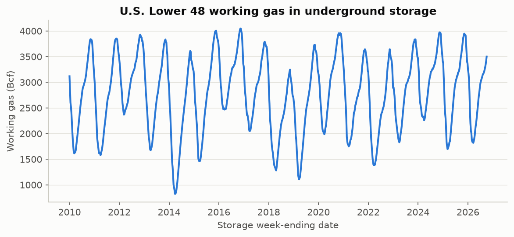

*Figure: Weekly working gas in storage (EIA series NW2_EPG0_SWO_R48_BCF, current vintage). The saw-tooth pattern is the annual injection (spring-autumn) and withdrawal (winter) cycle.*

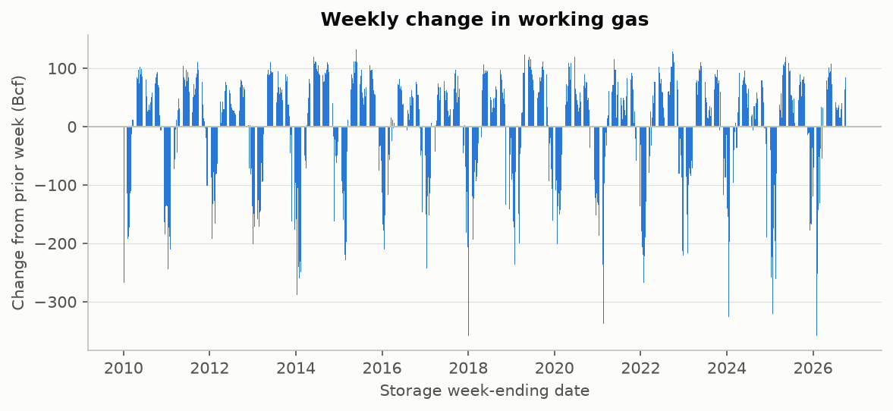

*Figure: Weekly storage change, S_t - S_(t-1). Positive = net injection; negative = net withdrawal.*

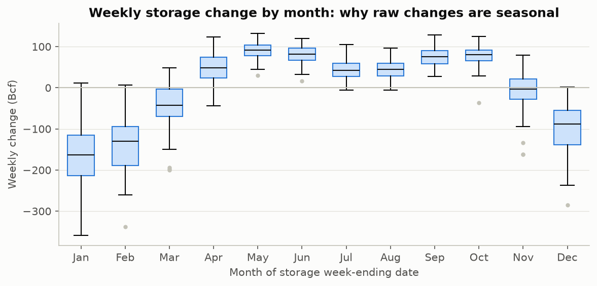

*Figure: Distribution of weekly storage changes by calendar month. Boxes span the middle 50%; the line is the median. A change that is normal in one month is extreme in another, so anomalies are measured against a seasonal baseline.*

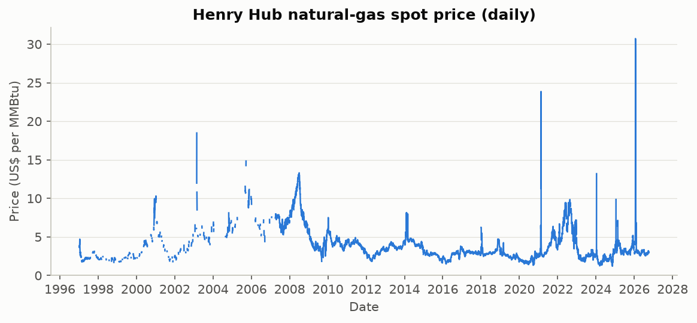

*Figure: FRED series DHHNGSP (source: EIA/Refinitiv). Gaps are market holidays or missing reports. The y-axis starts at zero to avoid exaggerating moves.*

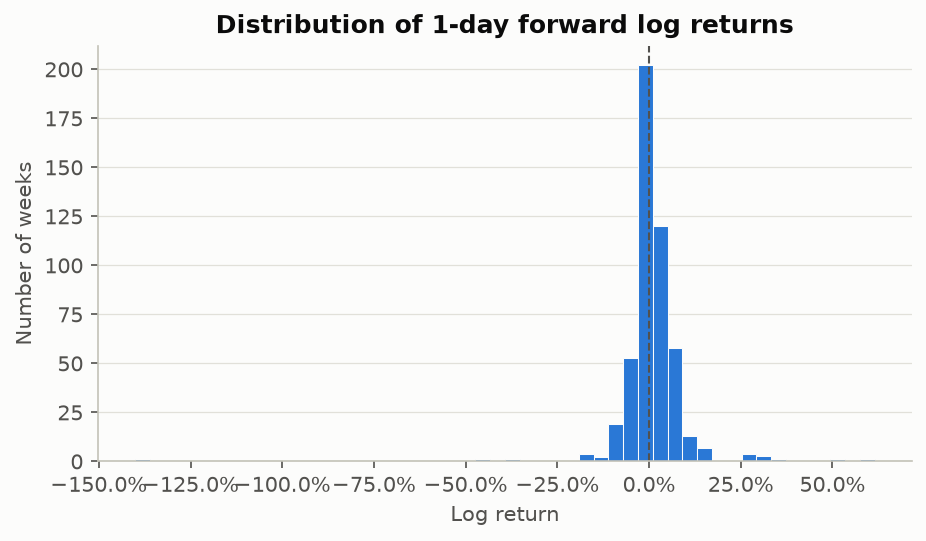

*Figure: One-day forward log returns from the first eligible post-release price (development sample). n = 491.*

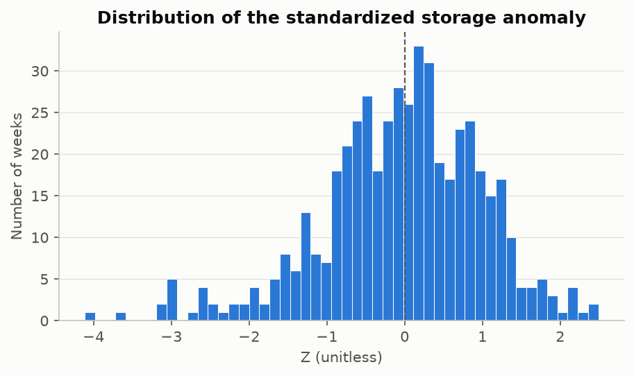

*Figure: Point-in-time standardized storage anomaly, expanding-mean method (development sample). n = 491.*

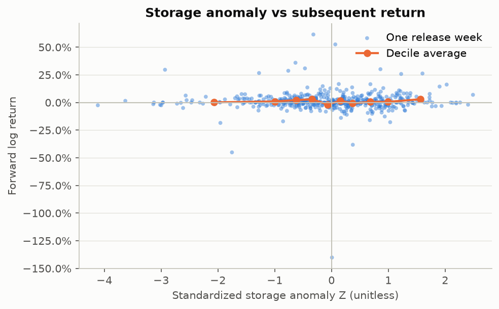

*Figure: Each dot is one release week (development sample); the line joins decile averages. n = 491. Association is not causation.*

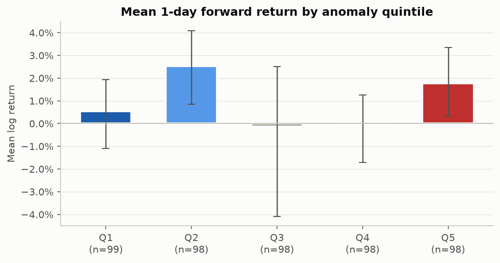

*Figure: Q1 = most negative anomalies (less gas than normal), Q5 = most positive. Error bars: 95% block-bootstrap intervals. Quintile cut points use the whole development sample, so this is descriptive, not a tradable rule.*

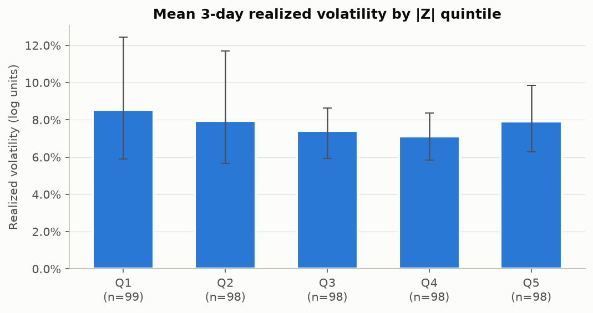

*Figure: Q1 = smallest absolute anomalies, Q5 = largest. Error bars: 95% block-bootstrap intervals.*

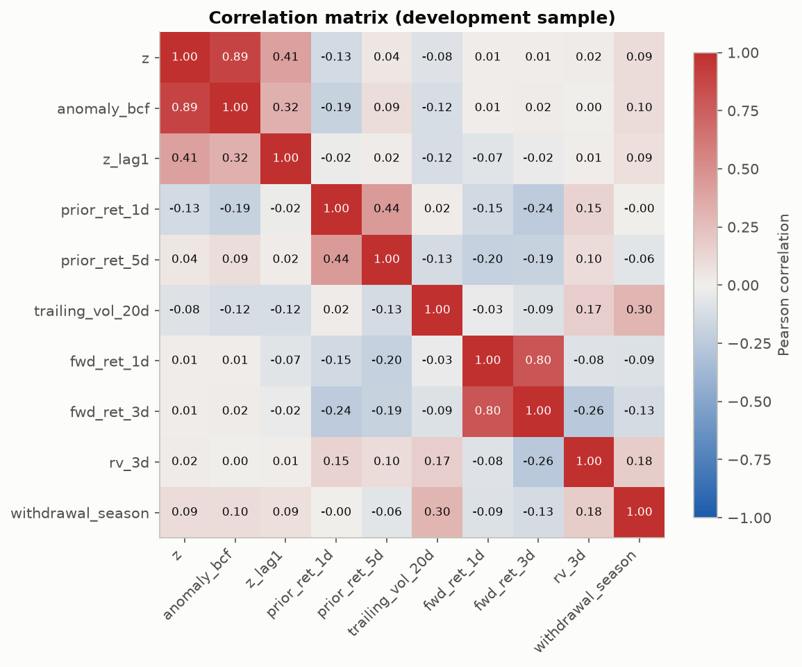

*Figure: Pearson correlations among features and targets in the development sample. Correlation is not causation.*

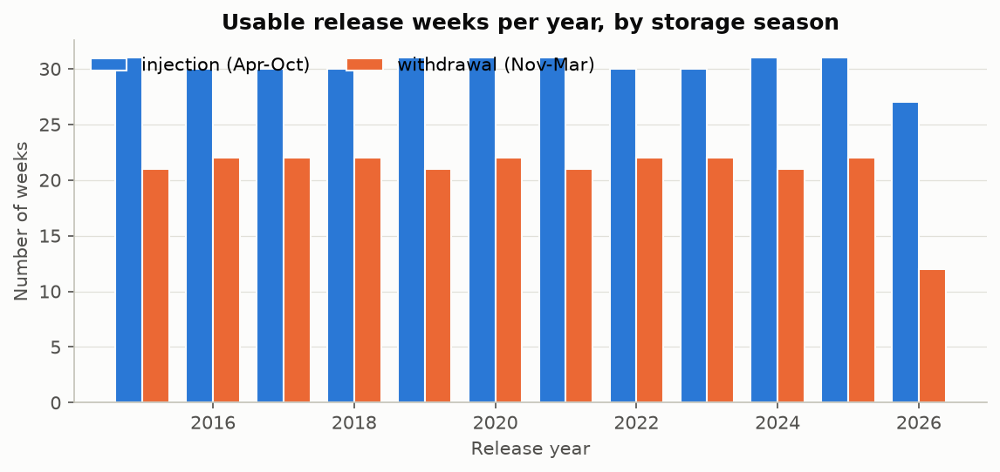

*Figure: Weeks with a valid anomaly and 1-day target. Early years are lost to the minimum-history requirement.*


### Quintile table: 1-day returns by z quintile

| group | n | mean | median | std | se | t_ci_low | t_ci_high | boot_ci_low | boot_ci_high | positive_freq | mean_abs | small_sample |
|---|---|---|---|---|---|---|---|---|---|---|---|---|
| Q1 | 99 | 0.005361 | 0 | 0.07367 | 0.007404 | -0.009333 | 0.02005 | -0.01089 | 0.01934 | 0.4747 | 0.0378 | no |
| Q2 | 98 | 0.02524 | 0.009654 | 0.08859 | 0.008949 | 0.007484 | 0.04301 | 0.008456 | 0.04081 | 0.551 | 0.04411 | no |
| Q3 | 98 | -0.001352 | 0 | 0.1612 | 0.01629 | -0.03368 | 0.03097 | -0.04094 | 0.02514 | 0.449 | 0.05754 | no |
| Q4 | 98 | -0.0007315 | 0 | 0.06434 | 0.006499 | -0.01363 | 0.01217 | -0.01705 | 0.01257 | 0.4592 | 0.03948 | no |
| Q5 | 98 | 0.01776 | 0.003425 | 0.07079 | 0.00715 | 0.003567 | 0.03195 | 0.003353 | 0.03356 | 0.5102 | 0.04705 | no |


### Quintile table: 3-day realized volatility by |z| quintile

| group | n | mean | median | std | se | t_ci_low | t_ci_high | boot_ci_low | boot_ci_high | positive_freq | mean_abs | small_sample |
|---|---|---|---|---|---|---|---|---|---|---|---|---|
| Q1 | 99 | 0.08559 | 0.05408 | 0.1513 | 0.0152 | 0.05542 | 0.1158 | 0.05883 | 0.1243 | 1.000 | 0.08559 | no |
| Q2 | 98 | 0.07943 | 0.05214 | 0.1481 | 0.01496 | 0.04973 | 0.1091 | 0.05673 | 0.1171 | 1.000 | 0.07943 | no |
| Q3 | 98 | 0.07425 | 0.05609 | 0.06979 | 0.00705 | 0.06026 | 0.08824 | 0.0594 | 0.08625 | 1.000 | 0.07425 | no |
| Q4 | 98 | 0.07104 | 0.05677 | 0.05663 | 0.00572 | 0.05969 | 0.0824 | 0.05828 | 0.08356 | 1.000 | 0.07104 | no |
| Q5 | 98 | 0.07933 | 0.05879 | 0.07672 | 0.00775 | 0.06395 | 0.09471 | 0.06279 | 0.09845 | 0.9898 | 0.07933 | no |


### Flags

| flag | value |
|---|---|
| Extreme anomalies |Z| > 3 (dev) | 5 |
| Largest |1-day return| (dev) | 1.402, 0.615, 0.525, 0.451, 0.382 |
| Share of squared 1-day returns from top 5 weeks | 61.8% |
| Event groups with n < 30 | see event-study tables (column small_sample) |

## 9. Event-study results

Development sample, fixed z thresholds (-1.5, -0.5, +0.5, +1.5). `boot_ci_*` are 95% moving-block bootstrap intervals; `small_sample` marks groups with fewer than 30 weeks.


| target | group | n | mean | median | std | se | t_ci_low | t_ci_high | boot_ci_low | boot_ci_high | positive_freq | mean_abs | small_sample |
|---|---|---|---|---|---|---|---|---|---|---|---|---|---|
| fwd_ret_1d | large_negative | 39 | -0.0004269 | 0 | 0.0975 | 0.01561 | -0.03203 | 0.03118 | -0.03302 | 0.02708 | 0.4103 | 0.04541 | no |
| fwd_ret_1d | moderate_negative | 106 | 0.01525 | 0.005571 | 0.06249 | 0.006069 | 0.003216 | 0.02728 | 0.003084 | 0.02262 | 0.5377 | 0.03554 | no |
| fwd_ret_1d | normal | 198 | 0.004711 | 0 | 0.1297 | 0.009217 | -0.01347 | 0.02289 | -0.01782 | 0.02184 | 0.4646 | 0.05007 | no |
| fwd_ret_1d | moderate_positive | 127 | 0.01048 | 0.004107 | 0.06529 | 0.005794 | -0.0009856 | 0.02195 | -0.0003991 | 0.02111 | 0.5197 | 0.04562 | no |
| fwd_ret_1d | large_positive | 21 | 0.03226 | 0 | 0.07467 | 0.01629 | -0.001731 | 0.06625 | -0.0009197 | 0.07124 | 0.4286 | 0.04465 | yes |
| fwd_ret_3d | large_negative | 39 | -0.01089 | 0.008097 | 0.1237 | 0.0198 | -0.05097 | 0.02919 | -0.05 | 0.021 | 0.5385 | 0.06811 | no |
| fwd_ret_3d | moderate_negative | 106 | 0.02144 | 0.01434 | 0.07376 | 0.007164 | 0.007237 | 0.03565 | 0.008736 | 0.03365 | 0.6226 | 0.05511 | no |
| fwd_ret_3d | normal | 198 | 0.00481 | 0.01078 | 0.1426 | 0.01014 | -0.01518 | 0.0248 | -0.01891 | 0.02256 | 0.5707 | 0.06879 | no |
| fwd_ret_3d | moderate_positive | 127 | 0.02157 | 0.01721 | 0.09204 | 0.008167 | 0.005404 | 0.03773 | 0.005653 | 0.03701 | 0.5906 | 0.0703 | no |
| fwd_ret_3d | large_positive | 21 | 0.007732 | 0.01912 | 0.1018 | 0.02221 | -0.03861 | 0.05407 | -0.02802 | 0.03638 | 0.5714 | 0.07826 | yes |
| fwd_ret_5d | large_negative | 39 | -0.02868 | -0.002699 | 0.1424 | 0.0228 | -0.07484 | 0.01748 | -0.07939 | 0.01346 | 0.4872 | 0.08753 | no |
| fwd_ret_5d | moderate_negative | 106 | 0.02337 | 0.01039 | 0.1509 | 0.01466 | -0.005695 | 0.05244 | -0.007108 | 0.05764 | 0.5472 | 0.08249 | no |
| fwd_ret_5d | normal | 197 | -0.01759 | -0.002535 | 0.1696 | 0.01209 | -0.04143 | 0.006243 | -0.04732 | 0.002508 | 0.467 | 0.08317 | no |
| fwd_ret_5d | moderate_positive | 127 | 0.02437 | -0.004141 | 0.1688 | 0.01497 | -0.005269 | 0.054 | 0.0002472 | 0.05735 | 0.4646 | 0.08366 | no |
| fwd_ret_5d | large_positive | 21 | 0.02961 | 0.01912 | 0.1304 | 0.02846 | -0.02975 | 0.08898 | -0.0162 | 0.07486 | 0.5238 | 0.09812 | yes |
| abs_ret_1d | large_negative | 39 | 0.04541 | 0.02069 | 0.08596 | 0.01377 | 0.01754 | 0.07327 | 0.02349 | 0.07485 | 0.7949 | 0.04541 | no |
| abs_ret_1d | moderate_negative | 106 | 0.03554 | 0.02286 | 0.05352 | 0.005198 | 0.02524 | 0.04585 | 0.02441 | 0.04226 | 0.8396 | 0.03554 | no |
| abs_ret_1d | normal | 198 | 0.05007 | 0.02461 | 0.1197 | 0.008506 | 0.0333 | 0.06685 | 0.03511 | 0.07139 | 0.8889 | 0.05007 | no |
| abs_ret_1d | moderate_positive | 127 | 0.04562 | 0.03469 | 0.0477 | 0.004233 | 0.03724 | 0.054 | 0.03777 | 0.05435 | 0.9055 | 0.04562 | no |
| abs_ret_1d | large_positive | 21 | 0.04465 | 0.01747 | 0.06764 | 0.01476 | 0.01386 | 0.07544 | 0.01561 | 0.07727 | 0.7143 | 0.04465 | yes |
| rv_3d | large_negative | 39 | 0.07776 | 0.05336 | 0.0963 | 0.01542 | 0.04654 | 0.109 | 0.05059 | 0.1106 | 1.000 | 0.07776 | no |
| rv_3d | moderate_negative | 106 | 0.06839 | 0.05196 | 0.0658 | 0.006391 | 0.05572 | 0.08106 | 0.05252 | 0.07835 | 0.9906 | 0.06839 | no |
| rv_3d | normal | 198 | 0.08232 | 0.05318 | 0.149 | 0.01059 | 0.06143 | 0.1032 | 0.06221 | 0.109 | 1.000 | 0.08232 | no |
| rv_3d | moderate_positive | 127 | 0.07755 | 0.06452 | 0.05955 | 0.005285 | 0.06709 | 0.08801 | 0.06596 | 0.09055 | 1.000 | 0.07755 | no |
| rv_3d | large_positive | 21 | 0.08769 | 0.06633 | 0.06847 | 0.01494 | 0.05652 | 0.1189 | 0.05233 | 0.1269 | 1.000 | 0.08769 | yes |
| reaction_ret | large_negative | 39 | -0.05033 | -0.007117 | 0.2599 | 0.04161 | -0.1346 | 0.0339 | -0.1506 | 0.008199 | 0.4103 | 0.08521 | no |
| reaction_ret | moderate_negative | 106 | -0.01925 | -0.01414 | 0.108 | 0.01049 | -0.04005 | 0.001552 | -0.04021 | 0.002105 | 0.3585 | 0.06158 | no |
| reaction_ret | normal | 198 | -0.007686 | -0.01459 | 0.1266 | 0.008999 | -0.02543 | 0.01006 | -0.02258 | 0.01245 | 0.3889 | 0.0578 | no |
| reaction_ret | moderate_positive | 127 | -0.01448 | -0.007576 | 0.0616 | 0.005466 | -0.0253 | -0.003662 | -0.02606 | -0.002453 | 0.4016 | 0.04479 | no |
| reaction_ret | large_positive | 21 | -0.02807 | -0.01905 | 0.108 | 0.02356 | -0.07722 | 0.02108 | -0.05632 | 0.001474 | 0.2857 | 0.07458 | yes |

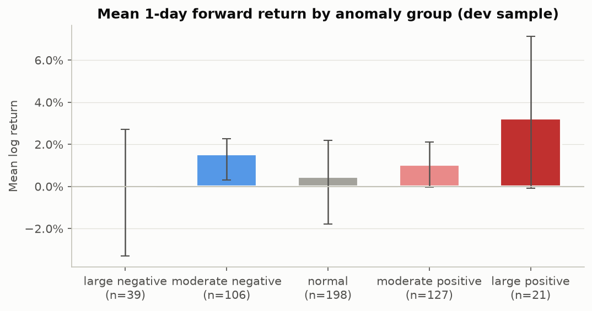

*Figure: Groups use fixed thresholds on point-in-time Z (-1.5, -0.5, +0.5, +1.5). Error bars: 95% block-bootstrap intervals. H1 predicts bars falling from left to right.*

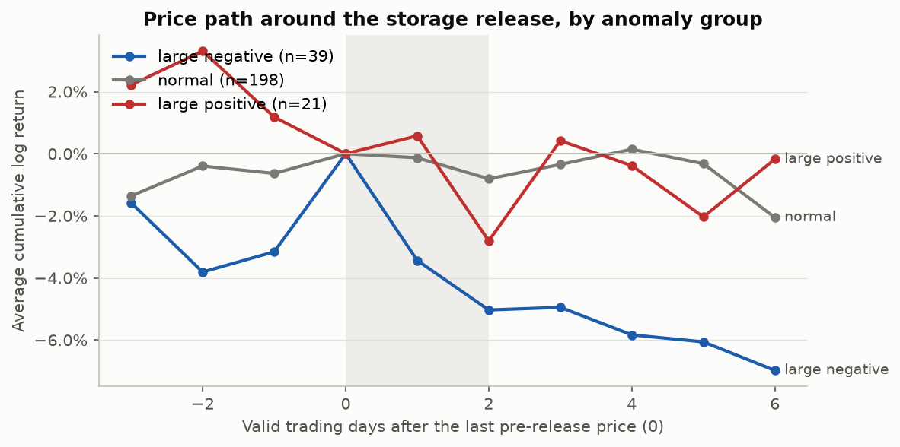

*Figure: Average cumulative log return measured from the last daily price before the release (day 0). The shaded span covers the release: day 1 is usually the release day itself, whose daily price mixes pre- and post-release trades; day 2 is usually the first tradable price. Daily data say nothing about intraday timing. Only the extreme groups and the middle group are drawn for legibility.*


Large-negative minus large-positive mean return (H1 predicts > 0):

| target | difference | boot_ci_low | boot_ci_high | boot_p_one_sided_le_0 | n_low | n_high |
|---|---|---|---|---|---|---|
| fwd_ret_1d | -0.03268 | -0.08451 | 0.01023 | 0.9055 | 39 | 21 |
| fwd_ret_3d | -0.01862 | -0.07047 | 0.03045 | 0.7765 | 39 | 21 |
| fwd_ret_5d | -0.05829 | -0.1262 | 0.001922 | 0.97 | 39 | 21 |


By storage season:

| storage_season | group | n | mean | median | std | se | t_ci_low | t_ci_high | boot_ci_low | boot_ci_high | positive_freq | mean_abs | small_sample |
|---|---|---|---|---|---|---|---|---|---|---|---|---|---|
| injection (Apr-Oct) | large_negative | 22 | 0.01638 | 0 | 0.03229 | 0.006885 | 0.002059 | 0.0307 | 0.003697 | 0.03016 | 0.4545 | 0.02626 | yes |
| injection (Apr-Oct) | moderate_negative | 72 | 0.02024 | 0.0101 | 0.06063 | 0.007146 | 0.005991 | 0.03449 | 0.007007 | 0.02546 | 0.5833 | 0.03579 | no |
| injection (Apr-Oct) | normal | 117 | 0.0167 | 0.004124 | 0.05638 | 0.005213 | 0.006371 | 0.02702 | 0.00517 | 0.02974 | 0.5214 | 0.03765 | no |
| injection (Apr-Oct) | moderate_positive | 60 | 0.01221 | 0.008761 | 0.05221 | 0.00674 | -0.001276 | 0.0257 | -0.001118 | 0.02508 | 0.5833 | 0.03705 | no |
| injection (Apr-Oct) | large_positive | 12 | 0.01474 | 0 | 0.05478 | 0.01581 | -0.02006 | 0.04954 | -0.00921 | 0.05859 | 0.3333 | 0.03096 | yes |
| withdrawal (Nov-Mar) | large_negative | 17 | -0.02217 | 0 | 0.1425 | 0.03457 | -0.09546 | 0.05111 | -0.08954 | 0.04026 | 0.3529 | 0.07019 | yes |
| withdrawal (Nov-Mar) | moderate_negative | 34 | 0.004684 | 0 | 0.06592 | 0.0113 | -0.01832 | 0.02768 | -0.01512 | 0.02809 | 0.4412 | 0.03502 | no |
| withdrawal (Nov-Mar) | normal | 81 | -0.0126 | 0 | 0.1905 | 0.02117 | -0.05473 | 0.02953 | -0.06204 | 0.02565 | 0.3827 | 0.06802 | no |
| withdrawal (Nov-Mar) | moderate_positive | 67 | 0.00893 | 0 | 0.07548 | 0.009221 | -0.00948 | 0.02734 | -0.009164 | 0.02619 | 0.4627 | 0.0533 | no |
| withdrawal (Nov-Mar) | large_positive | 9 | 0.05562 | 0.01143 | 0.09348 | 0.03116 | -0.01624 | 0.1275 | -0.002502 | 0.1351 | 0.5556 | 0.0629 | yes |


By subperiod:

| subperiod | group | n | mean | median | std | se | t_ci_low | t_ci_high | boot_ci_low | boot_ci_high | positive_freq | mean_abs | small_sample |
|---|---|---|---|---|---|---|---|---|---|---|---|---|---|
| before 2019-09-19 | large_negative | 22 | 0.0162 | 0 | 0.06682 | 0.01425 | -0.01343 | 0.04582 | -0.004529 | 0.0464 | 0.3636 | 0.02965 | yes |
| before 2019-09-19 | moderate_negative | 56 | 0.01556 | 0.006478 | 0.04573 | 0.00611 | 0.003312 | 0.0278 | 0.006591 | 0.02921 | 0.5357 | 0.02568 | no |
| before 2019-09-19 | normal | 92 | 0.007125 | 0 | 0.06333 | 0.006602 | -0.00599 | 0.02024 | -0.004434 | 0.02227 | 0.413 | 0.02899 | no |
| before 2019-09-19 | moderate_positive | 64 | 0.007713 | 0.005356 | 0.05724 | 0.007155 | -0.006586 | 0.02201 | -0.006722 | 0.02242 | 0.5312 | 0.03673 | no |
| before 2019-09-19 | large_positive | 11 | 0.005787 | 0 | 0.03124 | 0.009419 | -0.0152 | 0.02677 | -0.01129 | 0.02693 | 0.3636 | 0.02142 | yes |
| from 2019-09-19 | large_negative | 17 | -0.02194 | 0 | 0.1259 | 0.03053 | -0.08666 | 0.04278 | -0.08319 | 0.02572 | 0.4706 | 0.0658 | yes |
| from 2019-09-19 | moderate_negative | 50 | 0.01491 | 0.004581 | 0.07759 | 0.01097 | -0.007145 | 0.03696 | -0.008796 | 0.02408 | 0.54 | 0.04659 | no |
| from 2019-09-19 | normal | 106 | 0.002615 | 0.002267 | 0.1676 | 0.01628 | -0.02966 | 0.03489 | -0.03606 | 0.03102 | 0.5094 | 0.06837 | no |
| from 2019-09-19 | moderate_positive | 63 | 0.01329 | 0.004107 | 0.07292 | 0.009187 | -0.005075 | 0.03166 | -0.002817 | 0.02953 | 0.5079 | 0.05465 | no |
| from 2019-09-19 | large_positive | 10 | 0.06137 | 0.005714 | 0.0975 | 0.03083 | -0.008375 | 0.1311 | -0.006791 | 0.1393 | 0.5 | 0.0702 | yes |


Test period:

| target | group | n | mean | median | std | se | t_ci_low | t_ci_high | boot_ci_low | boot_ci_high | positive_freq | mean_abs | small_sample |
|---|---|---|---|---|---|---|---|---|---|---|---|---|---|
| fwd_ret_1d | large_negative | 16 | 1.945e-05 | 0.004 | 0.1065 | 0.02663 | -0.05674 | 0.05678 | -0.05473 | 0.05183 | 0.5 | 0.0736 | yes |
| fwd_ret_1d | moderate_negative | 30 | -0.05163 | -0.01068 | 0.1774 | 0.0324 | -0.1179 | 0.01463 | -0.1388 | 0.001903 | 0.3667 | 0.08356 | no |
| fwd_ret_1d | normal | 38 | 0.01414 | 0.01107 | 0.04953 | 0.008034 | -0.002141 | 0.03042 | -0.001109 | 0.0289 | 0.6316 | 0.0391 | no |
| fwd_ret_1d | moderate_positive | 31 | 0.0347 | 0.009245 | 0.09992 | 0.01795 | -0.001955 | 0.07135 | 0.009806 | 0.06403 | 0.5484 | 0.06331 | no |
| fwd_ret_1d | large_positive | 7 | 0.05242 | 0.05501 | 0.0636 | 0.02404 | -0.006396 | 0.1112 | -0.0001339 | 0.096 | 0.7143 | 0.06677 | yes |
| fwd_ret_3d | large_negative | 16 | 0.01103 | 0.04575 | 0.1017 | 0.02543 | -0.04318 | 0.06524 | -0.04462 | 0.05519 | 0.6875 | 0.07597 | yes |
| fwd_ret_3d | moderate_negative | 29 | -0.06241 | -0.02676 | 0.2002 | 0.03717 | -0.1386 | 0.01374 | -0.1658 | 0.007783 | 0.3793 | 0.1103 | yes |
| fwd_ret_3d | normal | 38 | 0.03204 | 0.02012 | 0.09581 | 0.01554 | 0.0005454 | 0.06353 | 0.005111 | 0.0609 | 0.6053 | 0.07304 | no |
| fwd_ret_3d | moderate_positive | 31 | 0.04355 | 0.02757 | 0.3192 | 0.05734 | -0.07354 | 0.1606 | -0.02908 | 0.1216 | 0.5806 | 0.1651 | no |
| fwd_ret_3d | large_positive | 7 | 0.02092 | 0.02335 | 0.02873 | 0.01086 | -0.005646 | 0.04749 | -0.01197 | 0.03506 | 0.8571 | 0.03048 | yes |
| fwd_ret_5d | large_negative | 16 | -0.0148 | -0.003229 | 0.1078 | 0.02696 | -0.07226 | 0.04267 | -0.06969 | 0.03652 | 0.5 | 0.08065 | yes |
| fwd_ret_5d | moderate_negative | 29 | -0.07088 | -0.01664 | 0.2282 | 0.04238 | -0.1577 | 0.01593 | -0.1866 | 0.0008238 | 0.4138 | 0.1293 | yes |
| fwd_ret_5d | normal | 38 | 0.01068 | 0.01038 | 0.1237 | 0.02006 | -0.02997 | 0.05133 | -0.02845 | 0.05096 | 0.6579 | 0.08999 | no |
| fwd_ret_5d | moderate_positive | 31 | 0.03401 | 0.003454 | 0.4856 | 0.08721 | -0.1441 | 0.2121 | -0.05331 | 0.136 | 0.5484 | 0.2137 | no |
| fwd_ret_5d | large_positive | 7 | 0.01135 | 0.02361 | 0.02849 | 0.01077 | -0.01499 | 0.0377 | -0.007061 | 0.03688 | 0.5714 | 0.027 | yes |
| abs_ret_1d | large_negative | 16 | 0.0736 | 0.0445 | 0.07461 | 0.01865 | 0.03384 | 0.1134 | 0.04208 | 0.1127 | 0.9375 | 0.0736 | yes |
| abs_ret_1d | moderate_negative | 30 | 0.08356 | 0.02875 | 0.1644 | 0.03001 | 0.02218 | 0.1449 | 0.03796 | 0.1593 | 0.9667 | 0.08356 | no |
| abs_ret_1d | normal | 38 | 0.0391 | 0.03655 | 0.03299 | 0.005351 | 0.02826 | 0.04994 | 0.03001 | 0.04888 | 0.9474 | 0.0391 | no |
| abs_ret_1d | moderate_positive | 31 | 0.06331 | 0.03673 | 0.08418 | 0.01512 | 0.03244 | 0.09419 | 0.03604 | 0.09503 | 0.871 | 0.06331 | no |
| abs_ret_1d | large_positive | 7 | 0.06677 | 0.05501 | 0.04528 | 0.01712 | 0.02489 | 0.1086 | 0.04062 | 0.09945 | 1.000 | 0.06677 | yes |
| rv_3d | large_negative | 16 | 0.1006 | 0.08415 | 0.07045 | 0.01761 | 0.06306 | 0.1381 | 0.06988 | 0.136 | 1.000 | 0.1006 | yes |
| rv_3d | moderate_negative | 29 | 0.1322 | 0.07583 | 0.1872 | 0.03475 | 0.06103 | 0.2034 | 0.07482 | 0.2216 | 1.000 | 0.1322 | yes |
| rv_3d | normal | 38 | 0.07906 | 0.07425 | 0.03711 | 0.00602 | 0.06687 | 0.09126 | 0.06856 | 0.09081 | 1.000 | 0.07906 | no |
| rv_3d | moderate_positive | 31 | 0.1499 | 0.08514 | 0.1777 | 0.03192 | 0.08469 | 0.2151 | 0.08361 | 0.2325 | 1.000 | 0.1499 | no |
| rv_3d | large_positive | 7 | 0.09034 | 0.07853 | 0.04979 | 0.01882 | 0.04429 | 0.1364 | 0.05321 | 0.128 | 1.000 | 0.09034 | yes |
| reaction_ret | large_negative | 16 | -0.05525 | -0.01497 | 0.1224 | 0.0306 | -0.1205 | 0.00996 | -0.1153 | -0.008033 | 0.3125 | 0.07363 | yes |
| reaction_ret | moderate_negative | 30 | -0.0002657 | -0.01517 | 0.1911 | 0.03488 | -0.07161 | 0.07108 | -0.06941 | 0.08108 | 0.3333 | 0.08616 | no |
| reaction_ret | normal | 38 | 0.008298 | 0.0161 | 0.07789 | 0.01264 | -0.0173 | 0.0339 | -0.02149 | 0.0339 | 0.6579 | 0.05794 | no |
| reaction_ret | moderate_positive | 31 | 0.00105 | -0.01508 | 0.3633 | 0.06525 | -0.1322 | 0.1343 | -0.1 | 0.1343 | 0.3871 | 0.1445 | no |
| reaction_ret | large_positive | 7 | -0.04692 | -0.0438 | 0.0417 | 0.01576 | -0.08549 | -0.008354 | -0.07052 | -0.007357 | 0.1429 | 0.04988 | yes |
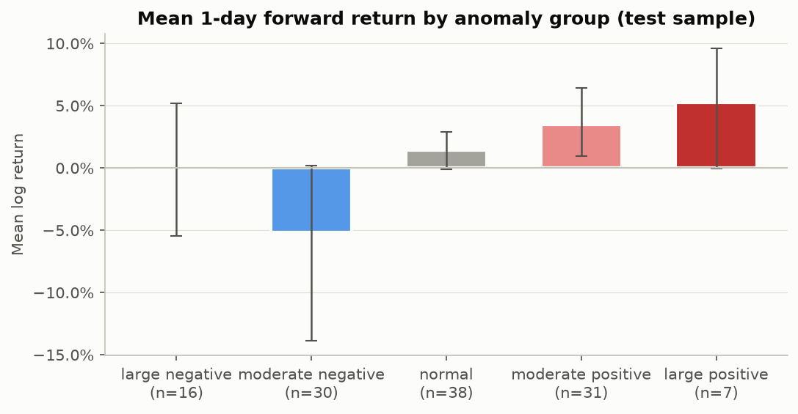

*Figure: Groups use fixed thresholds on point-in-time Z (-1.5, -0.5, +0.5, +1.5). Error bars: 95% block-bootstrap intervals. H1 predicts bars falling from left to right.*


Full sample (descriptive):

| target | group | n | mean | median | std | se | t_ci_low | t_ci_high | boot_ci_low | boot_ci_high | positive_freq | mean_abs | small_sample |
|---|---|---|---|---|---|---|---|---|---|---|---|---|---|
| fwd_ret_1d | large_negative | 55 | -0.0002971 | 0 | 0.0992 | 0.01338 | -0.02711 | 0.02652 | -0.02874 | 0.02765 | 0.4364 | 0.05361 | no |
| fwd_ret_1d | moderate_negative | 136 | 0.0004978 | 0.001236 | 0.1028 | 0.008818 | -0.01694 | 0.01794 | -0.01946 | 0.01735 | 0.5 | 0.04613 | no |
| fwd_ret_1d | normal | 236 | 0.006229 | 0 | 0.1204 | 0.007839 | -0.009214 | 0.02167 | -0.01158 | 0.02108 | 0.4915 | 0.0483 | no |
| fwd_ret_1d | moderate_positive | 158 | 0.01523 | 0.004301 | 0.07363 | 0.005858 | 0.00366 | 0.0268 | 0.00496 | 0.02577 | 0.5253 | 0.04909 | no |
| fwd_ret_1d | large_positive | 28 | 0.0373 | 0.005714 | 0.07147 | 0.01351 | 0.009586 | 0.06501 | 0.008684 | 0.0664 | 0.5 | 0.05018 | yes |
| fwd_ret_3d | large_negative | 55 | -0.004514 | 0.01412 | 0.1172 | 0.0158 | -0.0362 | 0.02717 | -0.03789 | 0.024 | 0.5818 | 0.0704 | no |
| fwd_ret_3d | moderate_negative | 135 | 0.00343 | 0.009245 | 0.1176 | 0.01012 | -0.01659 | 0.02345 | -0.0211 | 0.02369 | 0.5704 | 0.06696 | no |
| fwd_ret_3d | normal | 236 | 0.009194 | 0.0109 | 0.1364 | 0.008877 | -0.008294 | 0.02668 | -0.01117 | 0.02464 | 0.5763 | 0.06948 | no |
| fwd_ret_3d | moderate_positive | 158 | 0.02588 | 0.01909 | 0.1623 | 0.01291 | 0.0003728 | 0.05139 | 0.007949 | 0.04671 | 0.5886 | 0.0889 | no |
| fwd_ret_3d | large_positive | 28 | 0.01103 | 0.02123 | 0.08885 | 0.01679 | -0.02342 | 0.04548 | -0.01631 | 0.03575 | 0.6429 | 0.06631 | yes |
| fwd_ret_5d | large_negative | 55 | -0.02464 | -0.002699 | 0.1324 | 0.01786 | -0.06044 | 0.01116 | -0.06528 | 0.01029 | 0.4909 | 0.08553 | no |
| fwd_ret_5d | moderate_negative | 135 | 0.003127 | 0.008163 | 0.1739 | 0.01497 | -0.02648 | 0.03273 | -0.03324 | 0.03898 | 0.5185 | 0.09255 | no |
| fwd_ret_5d | normal | 235 | -0.01302 | 0 | 0.1632 | 0.01065 | -0.03399 | 0.007952 | -0.03801 | 0.005713 | 0.4979 | 0.08427 | no |
| fwd_ret_5d | moderate_positive | 158 | 0.02626 | -0.001919 | 0.2606 | 0.02073 | -0.0147 | 0.06721 | 0.001174 | 0.05804 | 0.481 | 0.1092 | no |
| fwd_ret_5d | large_positive | 28 | 0.02505 | 0.02137 | 0.1133 | 0.02142 | -0.0189 | 0.06899 | -0.008074 | 0.06166 | 0.5357 | 0.08034 | yes |
| abs_ret_1d | large_negative | 55 | 0.05361 | 0.02817 | 0.08315 | 0.01121 | 0.03113 | 0.07609 | 0.03433 | 0.07825 | 0.8364 | 0.05361 | no |
| abs_ret_1d | moderate_negative | 136 | 0.04613 | 0.02376 | 0.09182 | 0.007874 | 0.03056 | 0.06171 | 0.03175 | 0.06622 | 0.8676 | 0.04613 | no |
| abs_ret_1d | normal | 236 | 0.0483 | 0.02553 | 0.1104 | 0.007189 | 0.03414 | 0.06247 | 0.0358 | 0.06544 | 0.8983 | 0.0483 | no |
| abs_ret_1d | moderate_positive | 158 | 0.04909 | 0.03523 | 0.05683 | 0.004521 | 0.04016 | 0.05802 | 0.04057 | 0.05888 | 0.8987 | 0.04909 | no |
| abs_ret_1d | large_positive | 28 | 0.05018 | 0.03196 | 0.06277 | 0.01186 | 0.02584 | 0.07452 | 0.02545 | 0.07575 | 0.7857 | 0.05018 | yes |
| rv_3d | large_negative | 55 | 0.0844 | 0.05577 | 0.08952 | 0.01207 | 0.0602 | 0.1086 | 0.06286 | 0.1111 | 1.000 | 0.0844 | no |
| rv_3d | moderate_negative | 135 | 0.0821 | 0.05634 | 0.1068 | 0.009191 | 0.06392 | 0.1003 | 0.06397 | 0.107 | 0.9926 | 0.0821 | no |
| rv_3d | normal | 236 | 0.08179 | 0.05635 | 0.1372 | 0.008932 | 0.06419 | 0.09939 | 0.06567 | 0.1041 | 1.000 | 0.08179 | no |
| rv_3d | moderate_positive | 158 | 0.09174 | 0.06715 | 0.09854 | 0.007839 | 0.07625 | 0.1072 | 0.07387 | 0.1144 | 1.000 | 0.09174 | no |
| rv_3d | large_positive | 28 | 0.08835 | 0.0734 | 0.06345 | 0.01199 | 0.06375 | 0.113 | 0.05982 | 0.1178 | 1.000 | 0.08835 | yes |
| reaction_ret | large_negative | 55 | -0.05176 | -0.01036 | 0.2273 | 0.03065 | -0.1132 | 0.009693 | -0.1229 | -0.003218 | 0.3818 | 0.08184 | no |
| reaction_ret | moderate_negative | 136 | -0.01506 | -0.01414 | 0.1303 | 0.01117 | -0.03716 | 0.007035 | -0.03721 | 0.004377 | 0.3529 | 0.067 | no |
| reaction_ret | normal | 236 | -0.005112 | -0.01013 | 0.1201 | 0.00782 | -0.02052 | 0.01029 | -0.01877 | 0.01211 | 0.4322 | 0.05783 | no |
| reaction_ret | moderate_positive | 158 | -0.01143 | -0.007945 | 0.1682 | 0.01338 | -0.03787 | 0.015 | -0.03567 | 0.01501 | 0.3987 | 0.06435 | no |
| reaction_ret | large_positive | 28 | -0.03279 | -0.03186 | 0.09535 | 0.01802 | -0.06976 | 0.004189 | -0.05498 | -0.008986 | 0.25 | 0.0684 | yes |

## 10. Statistical models

**Model 1 (univariate OLS), development sample.** Newey-West errors are the basis for inference; classical errors are shown only to illustrate how much they can differ.

| term | coef | std_err | t | p_value | ci_low | ci_high | se_type |
|---|---|---|---|---|---|---|---|
| const | 0.009296 | 0.004595 | 2.023 | 0.04361 | 0.0002676 | 0.01832 | Newey-West HAC |
| z | 0.001275 | 0.003397 | 0.3753 | 0.7076 | -0.0054 | 0.00795 | Newey-West HAC |
| const | 0.009296 | 0.004454 | 2.087 | 0.03737 | 0.0005458 | 0.01805 | classical iid (for comparison only) |
| z | 0.001275 | 0.004321 | 0.2951 | 0.7681 | -0.007215 | 0.009765 | classical iid (for comparison only) |


n = 491, R^2 = 0.000178, adjusted R^2 = -0.001867, HAC lags = 5.


**Model 2 (multivariate OLS).**

| term | coef | std_err | t | p_value | ci_low | ci_high |
|---|---|---|---|---|---|---|
| const | 0.01951 | 0.004593 | 4.247 | 2.593e-05 | 0.01048 | 0.02853 |
| z | 0.002809 | 0.003526 | 0.7966 | 0.4261 | -0.004119 | 0.009737 |
| prior_ret_5d | -0.1178 | 0.03126 | -3.768 | 0.0001848 | -0.1792 | -0.05637 |
| trailing_vol_20d | -0.03984 | 0.0821 | -0.4853 | 0.6277 | -0.2012 | 0.1215 |
| withdrawal_season | -0.01903 | 0.01149 | -1.657 | 0.09821 | -0.04161 | 0.003539 |


n = 491, R^2 = 0.05139, adjusted R^2 = 0.04358.


**Residual diagnostics** (Ljung-Box: autocorrelation; Breusch-Pagan: heteroskedasticity; Jarque-Bera: normality; Cook's distance: influential weeks).

| model | lb_stat | lb_p | lags | bp_stat | bp_p | jb_stat | jb_p | skew | excess_kurtosis | durbin_watson | n_high_cooks | max_cooks |
|---|---|---|---|---|---|---|---|---|---|---|---|---|
| m1 | 0.3162 | 0.9887 | 4 | 0.01499 | 0.9025 | 169,517 | 0 | -5.179 | 90.436 | 1.960 | 16 | 0.2097 |
| m2 | 5.106 | 0.2766 | 4 | 4.991 | 0.2882 | 169,530 | 0 | -4.855 | 90.511 | 1.785 | 19 | 0.8452 |


**Variance inflation factors (Model 2).**

| variable | vif |
|---|---|
| z | 1.024 |
| prior_ret_5d | 1.019 |
| trailing_vol_20d | 1.129 |
| withdrawal_season | 1.118 |


**Influence check.** Dropping 16 high-influence weeks changes the z slope from 0.001275 to -6.544e-05 (p = 0.9677).

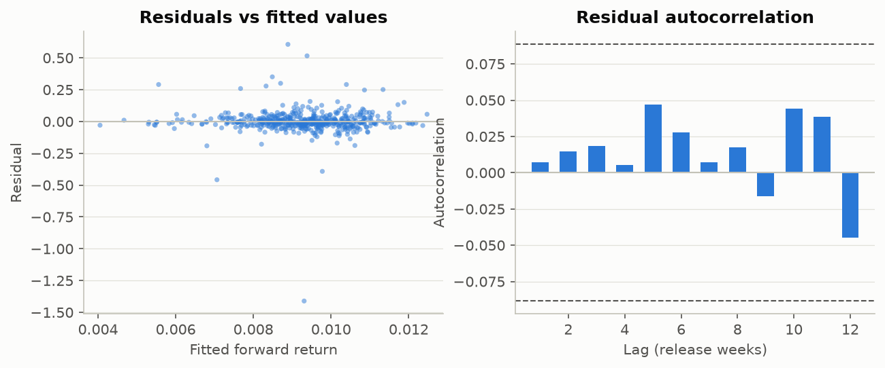

*Figure: Left: a funnel shape would indicate heteroskedasticity. Right: bars outside the dashed approximate 95% band indicate serial correlation. Both motivate Newey-West standard errors.*

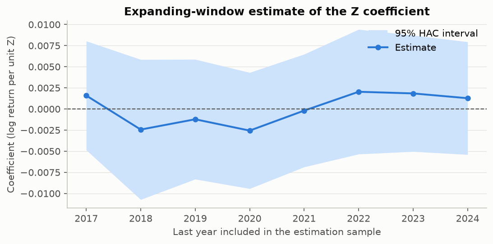

*Figure: Each point re-estimates the univariate regression using all data up to the year shown. A coefficient whose sign or size wanders, or whose band always straddles zero, is not stable evidence.*


**Secondary hypothesis: |z| and 3-day realized volatility** (controls: trailing volatility, season).

| term | coef | std_err | t | p_value | ci_low | ci_high |
|---|---|---|---|---|---|---|
| const | 0.05758 | 0.008712 | 6.609 | 1.015e-10 | 0.04046 | 0.0747 |
| abs_z | -0.007175 | 0.006754 | -1.062 | 0.2886 | -0.02045 | 0.006096 |
| trailing_vol_20d | 0.2487 | 0.1194 | 2.082 | 0.03787 | 0.01399 | 0.4833 |
| withdrawal_season | 0.03048 | 0.01361 | 2.239 | 0.02559 | 0.003735 | 0.05722 |

## 11. Validation design

| train_start | train_end | validation_start | validation_end | test_start | test_end | n_train | n_validation | n_test |
|---|---|---|---|---|---|---|---|---|
| 2015-01-08 | 2022-01-20 | 2022-01-27 | 2024-05-30 | 2024-06-06 | 2026-10-01 | 368 | 123 | 122 |


Models are fitted on train and compared on validation; hyperparameters for ridge, lasso and gradient boosting are tuned with `TimeSeriesSplit` inside the training rows only, with scaling inside the pipeline. The test period is evaluated once, after `frozen_spec.json` and `frozen_backtest.json` are written.

## 12. Out-of-sample results


**Training period (in-sample fit, for contrast).**

| model | n | mse | mae | oos_r2_vs_hist_mean | oos_r2_vs_zero | pearson | spearman_ic | hit_rate | clark_west_t | clark_west_p |
|---|---|---|---|---|---|---|---|---|---|---|
| zero | 367 | 0.005122 | 0.03744 | -0.02718 | 0 | n/a | n/a | n/a | 3.65e-16 | 0.5 |
| historical_mean | 367 | 0.004987 | 0.03859 | 0 | 0.02646 | n/a | n/a | 0.5742 | n/a | n/a |
| seasonal_mean | 367 | 0.004986 | 0.03856 | 9.905e-05 | 0.02656 | 0.009952 | 0.09663 | 0.5742 | 0.1869 | 0.4259 |
| m1_ols_z | 367 | 0.004987 | 0.03859 | 9.587e-07 | 0.02647 | 0.0009791 | 0.00962 | 0.5742 | 0.01933 | 0.4923 |
| m2_ols_controls | 367 | 0.004758 | 0.03902 | 0.04586 | 0.07111 | 0.2141 | 0.04053 | 0.5484 | 1.100 | 0.136 |
| m4_ridge | 367 | 0.00496 | 0.03856 | 0.005346 | 0.03167 | 0.2355 | 0.04999 | 0.5742 | 1.115 | 0.1328 |
| m4_lasso | 367 | 0.004987 | 0.03859 | 0 | 0.02646 | n/a | n/a | 0.5742 | n/a | n/a |
| m5_gbm | 367 | 0.004369 | 0.03644 | 0.1239 | 0.1471 | 0.4414 | 0.3133 | 0.629 | 3.123 | 0.0009666 |


**Validation period, return models.** Benchmark for OOS R^2 is the training-period mean.

| model | n | mse | mae | oos_r2_vs_hist_mean | oos_r2_vs_zero | pearson | spearman_ic | hit_rate | clark_west_t | clark_west_p |
|---|---|---|---|---|---|---|---|---|---|---|
| zero | 123 | 0.02373 | 0.06847 | 0.0034 | 0 | n/a | n/a | n/a | 0.6191 | 0.2685 |
| historical_mean | 123 | 0.02381 | 0.0691 | 0 | -0.003412 | n/a | n/a | 0.5391 | n/a | n/a |
| seasonal_mean | 123 | 0.02376 | 0.06895 | 0.001853 | -0.001553 | 0.2021 | 0.2353 | 0.5391 | 1.994 | 0.02417 |
| m1_ols_z | 123 | 0.02381 | 0.06911 | 2.705e-05 | -0.003385 | 0.0433 | -0.006363 | 0.5391 | 0.5671 | 0.2858 |
| m2_ols_controls | 123 | 0.02295 | 0.06839 | 0.03605 | 0.03276 | 0.2393 | 0.1966 | 0.5478 | 1.845 | 0.0337 |
| m4_ridge | 123 | 0.02376 | 0.06904 | 0.002153 | -0.001251 | 0.2222 | 0.06305 | 0.5391 | 1.932 | 0.02785 |
| m4_lasso | 123 | 0.02381 | 0.0691 | 0 | -0.003412 | n/a | n/a | 0.5391 | n/a | n/a |
| m5_gbm | 123 | 0.02402 | 0.07089 | -0.008976 | -0.01242 | 0.02015 | -0.06373 | 0.5304 | 0.176 | 0.4303 |


**Validation period, direction models.**

| model | n | positive_rate | accuracy | balanced_accuracy | roc_auc | log_loss | brier | tn | fp | fn | tp |
|---|---|---|---|---|---|---|---|---|---|---|---|
| majority_class | 123 | 0.5041 | 0.4959 | 0.5 | 0.5 | 0.6939 | 0.2504 | 61 | 0 | 62 | 0 |
| m3_logit_z | 123 | 0.5041 | 0.4878 | 0.4894 | 0.4336 | 0.7015 | 0.2542 | 42 | 19 | 44 | 18 |
| m3_logit_controls | 123 | 0.5041 | 0.5691 | 0.5689 | 0.5894 | 0.6804 | 0.2437 | 33 | 28 | 25 | 37 |


**Validation period, volatility models (target rv_3d).**

| model | n | mae | rmse | pearson | spearman | oos_r2_vs_hist_mean |
|---|---|---|---|---|---|---|
| historical_mean | 123 | 0.06391 | 0.1464 | n/a | n/a | 0 |
| trailing_vol_scaled | 123 | 0.08582 | 0.187 | 0.03713 | 0.2227 | -0.6313 |
| vol_ols_controls_only | 123 | 0.06298 | 0.1427 | 0.1124 | 0.2468 | 0.04965 |
| vol_ols_abs_z | 123 | 0.06294 | 0.1426 | 0.1138 | 0.2522 | 0.05067 |


**Permutation importance (validation).** Increase in MSE when a feature is shuffled; not evidence of causality.

| model | feature | mse_increase_mean | mse_increase_std |
|---|---|---|---|
| m4_ridge | z | 5.252e-08 | 1.218e-07 |
| m4_ridge | z_lag1 | 4.05e-06 | 3.665e-06 |
| m4_ridge | anomaly_bcf | -2.457e-07 | 7.686e-07 |
| m4_ridge | prior_ret_1d | 2.151e-05 | 9.99e-06 |
| m4_ridge | prior_ret_5d | 3.395e-05 | 9.951e-06 |
| m4_ridge | trailing_vol_20d | -1.29e-07 | 3.235e-06 |
| m4_ridge | withdrawal_season | 1.59e-06 | 7.316e-07 |
| m4_ridge | woy_sin | -4.545e-06 | 5.441e-06 |
| m4_ridge | woy_cos | -3.383e-06 | 1.271e-06 |
| m5_gbm | z | 3.2e-05 | 3.651e-05 |
| m5_gbm | z_lag1 | 0.0003373 | 0.0004168 |
| m5_gbm | anomaly_bcf | 5.52e-07 | 1.42e-05 |
| m5_gbm | prior_ret_1d | -0.0001066 | 0.0001056 |
| m5_gbm | prior_ret_5d | 5.486e-05 | 0.0001525 |
| m5_gbm | trailing_vol_20d | -2.301e-05 | 5.33e-05 |
| m5_gbm | withdrawal_season | 1.331e-05 | 8.221e-06 |
| m5_gbm | woy_sin | -0.0002009 | 0.0001554 |
| m5_gbm | woy_cos | 2.76e-05 | 6.385e-05 |


**Annual walk-forward, development years.**

| model | n | mse | mae | oos_r2_vs_hist_mean | oos_r2_vs_zero | pearson | spearman_ic | hit_rate | clark_west_t | clark_west_p |
|---|---|---|---|---|---|---|---|---|---|---|
| historical_mean | 335 | 0.01268 | 0.05306 | 0 | 0.005934 | -0.0309 | -0.0212 | 0.5466 | n/a | n/a |
| m1_ols_z | 335 | 0.01271 | 0.05323 | -0.002271 | 0.003677 | -0.05668 | -0.04813 | 0.5466 | -1.559 | 0.94 |
| m2_ols_controls | 335 | 0.01241 | 0.05378 | 0.02179 | 0.0276 | 0.1452 | 0.1346 | 0.5434 | 1.809 | 0.03569 |
| m4_lasso | 335 | 0.01256 | 0.05303 | 0.009588 | 0.01547 | 0.1134 | 0.004416 | 0.5466 | 1.602 | 0.05504 |
| m4_ridge | 335 | 0.01258 | 0.05301 | 0.008116 | 0.014 | 0.1503 | -0.01405 | 0.5402 | 1.457 | 0.07305 |
| m5_gbm | 335 | 0.01255 | 0.05321 | 0.01062 | 0.01649 | 0.1031 | 0.08553 | 0.5466 | 1.709 | 0.04423 |
| seasonal_mean | 335 | 0.01263 | 0.05307 | 0.003936 | 0.009847 | 0.08849 | 0.002682 | 0.5466 | 1.229 | 0.1099 |
| zero | 335 | 0.01276 | 0.05255 | -0.00597 | 0 | n/a | n/a | n/a | 0.2333 | 0.4079 |


**Test period (untouched until the final phase), return models.**

| model | n | mse | mae | oos_r2_vs_hist_mean | oos_r2_vs_zero | pearson | spearman_ic | hit_rate | clark_west_t | clark_west_p |
|---|---|---|---|---|---|---|---|---|---|---|
| zero | 122 | 0.01346 | 0.0623 | 0.001546 | 0 | n/a | n/a | n/a | 0.5369 | 0.2962 |
| historical_mean | 122 | 0.01348 | 0.06217 | 0 | -0.001549 | n/a | n/a | 0.5702 | n/a | n/a |
| seasonal_mean | 122 | 0.0132 | 0.06163 | 0.02065 | 0.01913 | 0.1918 | 0.1928 | 0.5965 | 1.771 | 0.03957 |
| m1_ols_z | 122 | 0.0134 | 0.06196 | 0.005691 | 0.004151 | 0.2392 | 0.2079 | 0.5702 | 2.080 | 0.01981 |
| m2_ols_controls | 122 | 0.01214 | 0.05987 | 0.09929 | 0.0979 | 0.3522 | 0.2751 | 0.5789 | 1.770 | 0.0396 |
| m4_ridge | 122 | 0.01263 | 0.05981 | 0.06334 | 0.06189 | 0.2993 | 0.2637 | 0.6228 | 2.011 | 0.02325 |
| m4_lasso | 122 | 0.01302 | 0.06128 | 0.03394 | 0.03244 | 0.2522 | 0.2165 | 0.6053 | 1.757 | 0.04071 |
| m5_gbm | 122 | 0.01297 | 0.06167 | 0.03809 | 0.0366 | 0.214 | 0.1999 | 0.5789 | 1.636 | 0.05223 |


**Test period, direction models.**

| model | n | positive_rate | accuracy | balanced_accuracy | roc_auc | log_loss | brier | tn | fp | fn | tp |
|---|---|---|---|---|---|---|---|---|---|---|---|
| majority_class | 122 | 0.5328 | 0.4672 | 0.5 | 0.5 | 0.6949 | 0.2509 | 57 | 0 | 65 | 0 |
| m3_logit_z | 122 | 0.5328 | 0.5082 | 0.5341 | 0.5722 | 0.6928 | 0.2498 | 53 | 4 | 56 | 9 |
| m3_logit_controls | 122 | 0.5328 | 0.5738 | 0.5622 | 0.5887 | 0.68 | 0.2432 | 22 | 35 | 17 | 48 |

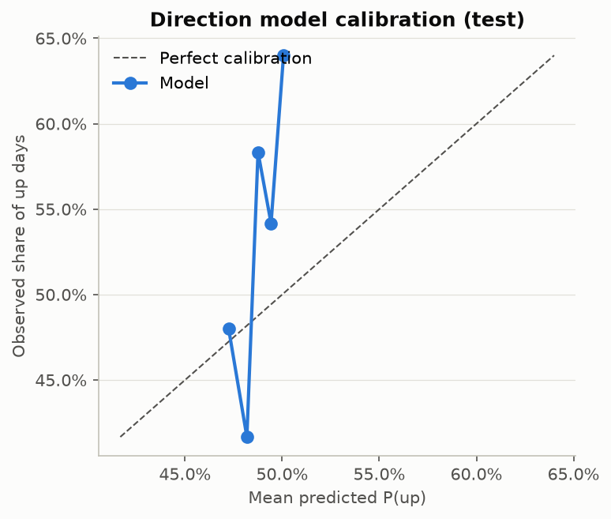

*Figure: Logistic model on Z, refitted on train+validation; quintile buckets of predicted probability.*


**Test period, volatility models.**

| model | n | mae | rmse | pearson | spearman | oos_r2_vs_hist_mean |
|---|---|---|---|---|---|---|
| historical_mean | 121 | 0.0617 | 0.1386 | n/a | n/a | 0 |
| trailing_vol_scaled | 121 | 0.08422 | 0.1606 | 0.3332 | 0.4978 | -0.3434 |
| vol_ols_controls_only | 121 | 0.05954 | 0.129 | 0.3951 | 0.4729 | 0.1328 |
| vol_ols_abs_z | 121 | 0.06001 | 0.1294 | 0.382 | 0.402 | 0.128 |


Volatility calibration (test):

| bucket | n | mean_prediction | mean_outcome |
|---|---|---|---|
| 1 | 25 | 0.05637 | 0.0718 |
| 2 | 24 | 0.06313 | 0.06999 |
| 3 | 24 | 0.06767 | 0.09118 |
| 4 | 24 | 0.09116 | 0.1176 |
| 5 | 24 | 0.1328 | 0.2184 |

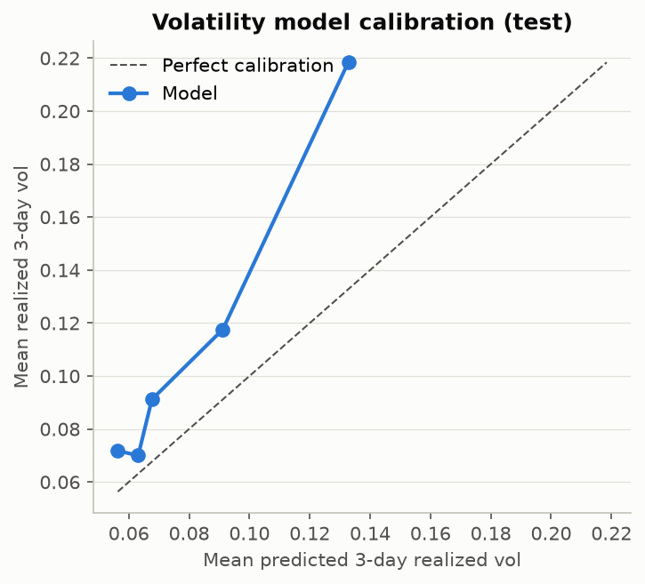

*Figure: Buckets of predicted volatility (quintiles).*


**Annual walk-forward, full sample.**

| model | n | mse | mae | oos_r2_vs_hist_mean | oos_r2_vs_zero | pearson | spearman_ic | hit_rate | clark_west_t | clark_west_p |
|---|---|---|---|---|---|---|---|---|---|---|
| historical_mean | 457 | 0.01289 | 0.05551 | 0 | 0.003892 | -0.01023 | -0.005029 | 0.5529 | n/a | n/a |
| m1_ols_z | 457 | 0.01288 | 0.05555 | 0.001262 | 0.005149 | 0.03203 | 0.009774 | 0.5553 | 0.6808 | 0.2482 |
| m2_ols_controls | 457 | 0.0124 | 0.05553 | 0.03832 | 0.04206 | 0.2002 | 0.171 | 0.5647 | 2.595 | 0.004877 |
| m4_lasso | 457 | 0.01255 | 0.05494 | 0.02704 | 0.03083 | 0.2097 | 0.08998 | 0.5647 | 1.797 | 0.03648 |
| m4_ridge | 457 | 0.01257 | 0.05496 | 0.02524 | 0.02903 | 0.2146 | 0.09114 | 0.5553 | 2.246 | 0.01259 |
| m5_gbm | 457 | 0.01258 | 0.05555 | 0.02424 | 0.02803 | 0.1598 | 0.09636 | 0.5576 | 2.197 | 0.01427 |
| seasonal_mean | 457 | 0.01278 | 0.05534 | 0.009076 | 0.01293 | 0.1346 | 0.08495 | 0.5647 | 2.153 | 0.01592 |
| zero | 457 | 0.01294 | 0.05515 | -0.003907 | 0 | n/a | n/a | n/a | 0.4907 | 0.3119 |


By year, primary model (all models in the CSV):

| model | year | n | mse | mae | oos_r2_vs_hist_mean | oos_r2_vs_zero | pearson | spearman_ic | hit_rate | clark_west_t | clark_west_p |
|---|---|---|---|---|---|---|---|---|---|---|---|
| m1_ols_z | 2018 | 52 | 0.003128 | 0.02953 | -0.01904 | -0.01901 | -0.306 | -0.009659 | 0.5333 | -1.019 | 0.8434 |
| m1_ols_z | 2019 | 52 | 0.003187 | 0.03788 | -0.01031 | 0.05906 | 0.02496 | -0.09655 | 0.6087 | -0.7492 | 0.7714 |
| m1_ols_z | 2020 | 53 | 0.006081 | 0.0559 | 0.003548 | 0.04662 | 0.1332 | 0.1527 | 0.5098 | 0.9281 | 0.1788 |
| m1_ols_z | 2021 | 52 | 0.01294 | 0.05251 | -0.006673 | -0.0001625 | -0.1207 | -0.05524 | 0.5294 | -1.218 | 0.8856 |
| m1_ols_z | 2022 | 52 | 0.009939 | 0.06369 | -0.0006092 | -0.005612 | -0.2126 | -0.08072 | 0.5 | -1.120 | 0.866 |
| m1_ols_z | 2023 | 52 | 0.004098 | 0.04907 | -0.001083 | 0.03736 | -0.009371 | -0.06004 | 0.5319 | -0.04681 | 0.5186 |
| m1_ols_z | 2024 | 52 | 0.04627 | 0.09033 | -0.0007063 | -0.0005462 | -0.03743 | -0.02327 | 0.6327 | -0.7049 | 0.758 |
| m1_ols_z | 2025 | 53 | 0.01744 | 0.06083 | 0.004295 | 0.002151 | 0.2974 | 0.378 | 0.5918 | 2.363 | 0.01096 |
| m1_ols_z | 2026 | 39 | 0.01285 | 0.06163 | 0.02669 | 0.002747 | 0.35 | 0.2155 | 0.5676 | 1.276 | 0.1049 |


By storage season:

| model | storage_season | n | mse | mae | oos_r2_vs_hist_mean | oos_r2_vs_zero | pearson | spearman_ic | hit_rate | clark_west_t | clark_west_p |
|---|---|---|---|---|---|---|---|---|---|---|---|
| historical_mean | injection (Apr-Oct) | 272 | 0.003803 | 0.04208 | 0 | 0.07565 | 0.0008518 | -0.004569 | 0.6047 | n/a | n/a |
| historical_mean | withdrawal (Nov-Mar) | 185 | 0.02626 | 0.07525 | 0 | -0.01285 | -0.01504 | 0.007846 | 0.4767 | n/a | n/a |
| m1_ols_z | injection (Apr-Oct) | 272 | 0.003805 | 0.0421 | -0.0006247 | 0.07507 | 0.03715 | 0.02911 | 0.6047 | 0.1773 | 0.4297 |
| m1_ols_z | withdrawal (Nov-Mar) | 185 | 0.02622 | 0.07533 | 0.001664 | -0.01116 | 0.05951 | 0.03326 | 0.4826 | 0.6702 | 0.2518 |
| m2_ols_controls | injection (Apr-Oct) | 272 | 0.003689 | 0.0418 | 0.03006 | 0.1034 | 0.156 | 0.1146 | 0.5889 | 2.178 | 0.01512 |
| m2_ols_controls | withdrawal (Nov-Mar) | 185 | 0.02521 | 0.07572 | 0.04007 | 0.02774 | 0.1969 | 0.2439 | 0.5291 | 2.329 | 0.01046 |
| m4_lasso | injection (Apr-Oct) | 272 | 0.003718 | 0.04177 | 0.02223 | 0.0962 | 0.1447 | 0.05615 | 0.6008 | 1.913 | 0.02837 |
| m4_lasso | withdrawal (Nov-Mar) | 185 | 0.02552 | 0.07432 | 0.02807 | 0.01558 | 0.2197 | 0.1311 | 0.5116 | 1.541 | 0.06255 |
| m4_ridge | injection (Apr-Oct) | 272 | 0.003728 | 0.04175 | 0.01966 | 0.09382 | 0.1176 | 0.05763 | 0.5968 | 2.211 | 0.01394 |
| m4_ridge | withdrawal (Nov-Mar) | 185 | 0.02557 | 0.07438 | 0.02642 | 0.01391 | 0.2132 | 0.11 | 0.4942 | 1.992 | 0.02395 |
| m5_gbm | injection (Apr-Oct) | 272 | 0.003767 | 0.04253 | 0.009484 | 0.08441 | 0.1002 | 0.07079 | 0.5889 | 1.282 | 0.1005 |
| m5_gbm | withdrawal (Nov-Mar) | 185 | 0.02554 | 0.0747 | 0.02738 | 0.01488 | 0.1792 | 0.1138 | 0.5116 | 1.866 | 0.0318 |
| seasonal_mean | injection (Apr-Oct) | 272 | 0.003774 | 0.04207 | 0.007631 | 0.0827 | 0.02518 | 0.04025 | 0.6047 | 1.620 | 0.05324 |
| seasonal_mean | withdrawal (Nov-Mar) | 185 | 0.02601 | 0.07486 | 0.009383 | -0.003345 | 0.1274 | 0.07588 | 0.5058 | 1.832 | 0.03432 |
| zero | injection (Apr-Oct) | 272 | 0.004114 | 0.04281 | -0.08184 | 0 | n/a | n/a | n/a | -2.655 | 0.9958 |
| zero | withdrawal (Nov-Mar) | 185 | 0.02593 | 0.0733 | 0.01269 | 0 | n/a | n/a | n/a | 1.864 | 0.03195 |

## 13. Backtest methodology

Rule: long if z <= -k, short if z >= +k, flat otherwise. Entry at the first eligible post-release price; exit 1 valid price(s) later; no overlapping positions. Costs per side: 10 bps commission-like cost + 5 bps slippage (both configurable). k is chosen from [0.5, 1.0, 1.5, 2.0] on the validation period only. Sharpe ratio = mean/std of weekly event returns (0 when flat) x sqrt(52), zero risk-free rate. Benchmarks: no trade, always long, a fixed-seed random signal with the same activity level, and 1000 random placebo draws.

**This is an economic-signal simulation on the Henry Hub spot index, which is not directly tradable. It is not an executable strategy.** A futures or ETF implementation would face roll yield, contract expiry, fees, tracking error and different timing.

## 14. Backtest results


Threshold selection (validation only):

| k | n_trades | mean_net_return_per_week | sharpe_net | cumulative_return_net | hit_rate |
|---|---|---|---|---|---|
| 0.5 | 74 | -0.007182 | -0.6869 | -0.7147 | 0.473 |
| 1.000 | 37 | -0.007775 | -1.293 | -0.6645 | 0.4595 |
| 1.500 | 14 | -0.004361 | -0.863 | -0.4696 | 0.5 |
| 2.000 | 4 | 0.0001664 | 0.6971 | 0.02049 | 0.75 |


Train and validation periods:

| period | portfolio | weeks | n_trades | n_long | n_short | skipped_overlap | cumulative_return_gross | cumulative_return_net | annualized_return_net | annualized_vol_net | sharpe_net | sharpe_gross | annualization_factor | max_drawdown_net | mean_net_return_per_week | hit_rate | avg_gain | avg_loss | total_costs | one_way_trades_per_year |
|---|---|---|---|---|---|---|---|---|---|---|---|---|---|---|---|---|---|---|---|---|
| train | strategy | 368 | 46 | 33 | 13 | 0 | -0.2386 | -0.3378 | -0.05659 | 0.2128 | -0.1581 | -0.06659 | sqrt(52) on weekly event returns | -0.4603 | -0.0006471 | 0.3261 | 0.05268 | -0.03317 | 0.138 | 13.080 |
| train | always_long | 368 | 368 | 368 | 0 | 0 | 69.282 | 22.500 | 0.5622 | 0.5866 | 1.005 | 1.271 | sqrt(52) on weekly event returns | -0.3978 | 0.01133 | 0.481 | 0.0525 | -0.02681 | 1.104 | 104.641 |
| train | random_signal_seed | 368 | 47 | 34 | 13 | 0 | 0.8365 | 0.5971 | 0.0684 | 0.1739 | 0.4585 | 0.5687 | sqrt(52) on weekly event returns | -0.1428 | 0.001534 | 0.4468 | 0.05664 | -0.02405 | 0.141 | 13.365 |
| train | no_trade | 368 | 0 | 0 | 0 | 0 | 0 | 0 | 0 | 0 | n/a | n/a | sqrt(52) on weekly event returns | 0 | 0 | n/a | n/a | n/a | 0 | 0 |
| validation | strategy | 123 | 14 | 6 | 8 | 0 | -0.4456 | -0.4696 | -0.2351 | 0.2628 | -0.863 | -0.8022 | sqrt(52) on weekly event returns | -0.5188 | -0.004361 | 0.5 | 0.03034 | -0.107 | 0.042 | 11.975 |
| validation | always_long | 123 | 123 | 123 | 0 | 0 | 0.3343 | -0.08307 | -0.036 | 0.8233 | 0.5417 | 0.7311 | sqrt(52) on weekly event returns | -0.8674 | 0.008576 | 0.4878 | 0.07498 | -0.05466 | 0.369 | 105.213 |
| validation | random_signal_seed | 123 | 16 | 4 | 12 | 0 | 0.6123 | 0.5385 | 0.1998 | 0.3084 | 0.7168 | 0.7777 | sqrt(52) on weekly event returns | -0.1563 | 0.004252 | 0.5625 | 0.08225 | -0.03104 | 0.048 | 13.686 |
| validation | no_trade | 123 | 0 | 0 | 0 | 0 | 0 | 0 | 0 | 0 | n/a | n/a | sqrt(52) on weekly event returns | 0 | 0 | n/a | n/a | n/a | 0 | 0 |

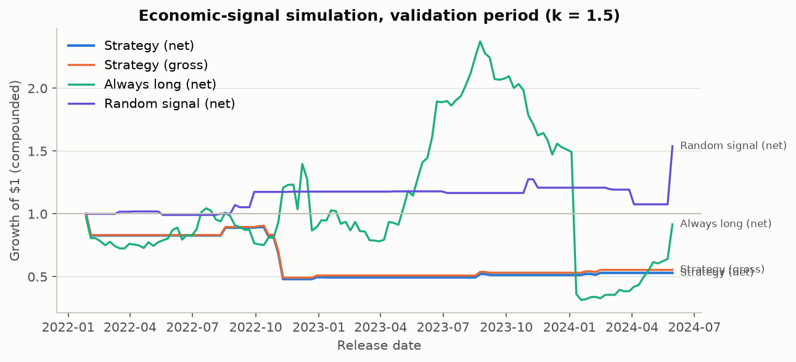

*Figure: Spot-price simulation, not an executable strategy. Costs: 10 bps + 5 bps slippage per side; holding 1 trading day(s).*


Test period (frozen k):

| period | portfolio | weeks | n_trades | n_long | n_short | skipped_overlap | cumulative_return_gross | cumulative_return_net | annualized_return_net | annualized_vol_net | sharpe_net | sharpe_gross | annualization_factor | max_drawdown_net | mean_net_return_per_week | hit_rate | avg_gain | avg_loss | total_costs | one_way_trades_per_year |
|---|---|---|---|---|---|---|---|---|---|---|---|---|---|---|---|---|---|---|---|---|
| test | strategy | 122 | 23 | 16 | 7 | 0 | -0.3404 | -0.3854 | -0.1874 | 0.2975 | -0.5386 | -0.4416 | sqrt(52) on weekly event returns | -0.5884 | -0.003082 | 0.4348 | 0.06424 | -0.07833 | 0.069 | 19.836 |
| test | always_long | 122 | 122 | 122 | 0 | 0 | 0.5392 | 0.06521 | 0.02729 | 0.739 | 0.4653 | 0.6764 | sqrt(52) on weekly event returns | -0.6858 | 0.006613 | 0.5246 | 0.06393 | -0.05663 | 0.366 | 105.220 |
| test | random_signal_seed | 122 | 23 | 13 | 10 | 0 | -0.735 | -0.7541 | -0.4501 | 0.469 | -0.9197 | -0.861 | sqrt(52) on weekly event returns | -0.7959 | -0.008295 | 0.3478 | 0.05234 | -0.09538 | 0.069 | 19.836 |
| test | no_trade | 122 | 0 | 0 | 0 | 0 | 0 | 0 | 0 | 0 | n/a | n/a | sqrt(52) on weekly event returns | 0 | 0 | n/a | n/a | n/a | 0 | 0 |

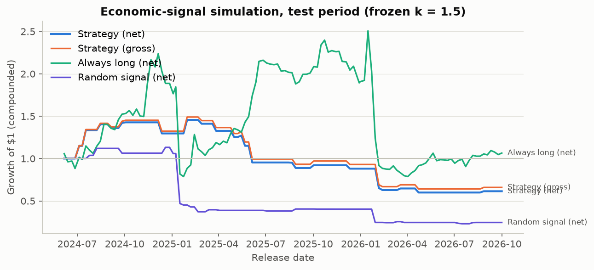

*Figure: Spot-price simulation on the untouched test period, not an executable strategy.*


Cost sensitivity (same trades):

| one_way_cost_bps | slippage_bps | mean_net_return_per_week | sharpe_net | cumulative_return_net |
|---|---|---|---|---|
| 0 | 5.000 | -0.002705 | -0.4741 | -0.3557 |
| 5.000 | 5.000 | -0.002893 | -0.5064 | -0.3707 |
| 10.000 | 5.000 | -0.003082 | -0.5386 | -0.3854 |
| 25.000 | 5.000 | -0.003647 | -0.6344 | -0.4275 |
| 50.000 | 5.000 | -0.00459 | -0.7907 | -0.4916 |


Share of random placebo strategies at least as good as the rule: 79.6%.

## 15. Robustness checks

Every variant is reported, not only the favourable ones. Development sample; HAC errors.

| variant | feature | target | n | beta | se_hac | p_value | beta_per_1sd | expected_sign | sign_as_hypothesized | significant_5pct | note |
|---|---|---|---|---|---|---|---|---|---|---|---|
| baseline: z expanding mean, 1-day | z | fwd_ret_1d | 491.000 | 0.001275 | 0.003397 | 0.7076 | 0.001315 | negative | no | no | n/a |
| seasonal method: expanding_median | z_expanding_median | fwd_ret_1d | 491.000 | 0.0008482 | 0.003227 | 0.7928 | 0.0009063 | negative | no | no | n/a |
| seasonal method: rolling_mean | z_rolling_mean | fwd_ret_1d | 491.000 | 0.002511 | 0.003953 | 0.5256 | 0.002644 | negative | no | no | n/a |
| seasonal method: rolling_median | z_rolling_median | fwd_ret_1d | 491.000 | 0.001349 | 0.003879 | 0.728 | 0.001602 | negative | no | no | n/a |
| comparable window +/-17 days | z_alt | fwd_ret_1d | 491.000 | 0.0008145 | 0.003851 | 0.8326 | 0.0007607 | negative | no | no | n/a |
| comparable window +/-24 days | z_alt | fwd_ret_1d | 491.000 | 0.001181 | 0.004022 | 0.7692 | 0.00104 | negative | no | no | n/a |
| raw anomaly (Bcf) instead of z | anomaly_bcf | fwd_ret_1d | 491.000 | 2.417e-05 | 0.0001013 | 0.8115 | 0.001001 | negative | no | no | n/a |
| target fwd_ret_3d | z | fwd_ret_3d | 491.000 | 0.0009995 | 0.003549 | 0.7783 | 0.001031 | negative | no | no | n/a |
| target fwd_ret_5d | z | fwd_ret_5d | 490.000 | 0.00759 | 0.006822 | 0.2664 | 0.007832 | negative | no | no | n/a |
| season: injection (Apr-Oct) | z | fwd_ret_1d | 283.000 | -0.00192 | 0.002948 | 0.5154 | -0.001935 | negative | yes | no | n/a |
| season: withdrawal (Nov-Mar) | z | fwd_ret_1d | 208.000 | 0.007065 | 0.006765 | 0.2975 | 0.007441 | negative | no | no | n/a |
| early half (< 2019-09-19) | z | fwd_ret_1d | 245.000 | -0.002315 | 0.003602 | 0.521 | -0.002492 | negative | yes | no | n/a |
| late half (>= 2019-09-19) | z | fwd_ret_1d | 246.000 | 0.005605 | 0.005757 | 0.3312 | 0.005518 | negative | no | no | n/a |
| exclude |z| > 3 | z | fwd_ret_1d | 486.000 | 0.0007523 | 0.003846 | 0.845 | 0.0007349 | negative | no | no | n/a |
| exclude top/bottom 1% returns | z | fwd_ret_1d | 481.000 | 0.0002327 | 0.00295 | 0.9372 | 0.0002402 | negative | no | no | n/a |
| winsorized z (bounds from train only) | z_w | fwd_ret_1d | 491.000 | 0.001233 | 0.003523 | 0.7265 | 0.001248 | negative | no | no | n/a |
| exclude weeks with uncertain release date | z | fwd_ret_1d | 452.000 | 0.001603 | 0.003702 | 0.6652 | 0.001648 | negative | no | no | n/a |
| entry on 2nd price after release | z | fwd_ret_1d | 491.000 | 0.0007261 | 0.00257 | 0.7777 | 0.0007486 | negative | no | no | n/a |
| subsample before 2022 (pre Europe gas crisis / Freeport outage) | z | fwd_ret_1d | 365.000 | -0.0001926 | 0.003394 | 0.9548 | -0.0002039 | negative | yes | no | n/a |
| subsample from 2022-01-01 | z | fwd_ret_1d | 126.000 | 0.007661 | 0.009089 | 0.4009 | 0.007221 | negative | no | no | n/a |
| vol: |z| -> rv_3d (no controls) | abs_z | rv_3d | 491.000 | -0.003096 | 0.006989 | 0.658 | -0.002044 | positive | no | no | n/a |
| M2 without prior returns | z | fwd_ret_1d | 491.000 | 0.002097 | 0.003384 | 0.5357 | n/a | negative | no | no | n/a |
| M2 without seasonal control | z | fwd_ret_1d | 491.000 | 0.001702 | 0.003521 | 0.6291 | n/a | negative | no | no | n/a |
| M2 full | z | fwd_ret_1d | 491.000 | 0.002809 | 0.003526 | 0.4261 | n/a | negative | no | no | n/a |
| spot vs tradable futures proxy | n/a | n/a | n/a | n/a | n/a | n/a | n/a | n/a | n/a | n/a | not run: optional futures data not enabled |

## 16. Limitations

* **Spot price is not directly tradable.** Henry Hub spot is a volume-weighted
  index of physical next-day deals. Backtests are economic-signal simulations.
* **Daily resolution.** The market reacts to the 10:30 a.m. release within
  minutes; daily data cannot measure that and our timing skips the release day.
  Any information absorbed on the release day is invisible here by design.
* **No consensus forecast.** Seasonal anomalies are not market surprises. Much
  of an anomaly is predictable from weather already known before the release.
* **Current-vintage data.** EIA revises storage estimates (including
  reclassifications between base and working gas). Weekly changes computed from
  today's levels can differ from the net change printed on release day. FRED
  serves latest-vintage prices.
* **Release dates before 2025 are rule-based**, not verified week by week.
  Unknown ad-hoc closures or delays (e.g. government shutdowns) could make an
  assumed release date too early; such weeks may be mis-timed.
* **Sample size.** Weekly data since 2010, minus five years of history for the
  baseline, leaves roughly 600 release weeks; extreme-anomaly groups contain
  far fewer. Fat-tailed returns make averages sensitive to a handful of weeks.
* **Structural change.** Shale growth, LNG exports since 2016, the 2021 Texas
  freeze, and the 2022 European crisis changed price dynamics; a relationship
  estimated on one regime may not carry over.
* **Multiple comparisons.** Many secondary tests are reported; some will look
  significant by chance.

## 17. Negative findings

* Development sample: the z coefficient was 0.00127 (HAC p = 0.708); H1's predicted negative, significant relationship was not found.
* Robustness: 13% of 23 return variants had the H1 (negative) sign; 0 were significant at 5% (uncorrected for multiple testing).
* Volatility: adding |z| did not reduce test-period MAE relative to trailing-volatility controls.
* Backtest: the frozen threshold rule did not earn a positive mean net return in the test period.

## 18. Potential extensions

* Add a consensus storage forecast (e.g. survey medians) to measure true market
  surprises, then compare with the seasonal anomaly.
* Add NOAA heating/cooling degree days to model the weather-predictable part of
  storage changes and isolate the unpredictable part.
* Use front-month NYMEX futures settlement prices (optionally downloaded by
  `scripts/download_data.py --include-optional`) as a tradable proxy. Futures
  settle at 2:30 p.m. ET, after the release, but returns spanning contract rolls
  must be removed, and settlement-price execution is itself an assumption.
* Build a point-in-time vintage history from ALFRED and archived EIA reports.
* Storage level relative to the five-year range; production, LNG exports,
  sector consumption as controls.

## 19. Reproducibility instructions

```bash
python -m venv .venv && source .venv/bin/activate
pip install -e ".[dev]"
git init && git add -A && git commit -m "Pre-registered protocol, before data"
cp .env.example .env            # then put your EIA key in .env
pytest
python scripts/download_data.py
python scripts/build_dataset.py
python scripts/run_analysis.py --phase development
python scripts/run_backtest.py --phase development
python scripts/run_analysis.py --phase final --note "first test evaluation"
python scripts/run_backtest.py --phase final
```

## 20. Conclusion

_These answers are generated mechanically from the pre-registered rules and the tables above; they should be read together with the limitations._

* **Did storage anomalies contain statistically reliable information about returns?** No, not by the pre-registered rule.
* **Was the relationship stable out of sample?** Test OOS R^2 = 0.0057; 33% of 9 walk-forward years had positive OOS R^2.
* **Was it economically meaningful?** No: the estimated slope does not even have the hypothesized (negative) sign.
* **Did it survive assumed costs?** No.
* **Volatility (secondary hypothesis):** not supported (requires a positive, significant development slope on |z| AND lower test MAE than controls alone: 0.06001 with |z| vs 0.05954 without).
* **Supported:** only the statements above that passed their tests. **Not supported:** any claim of causality, of a market 'surprise' effect, or of an executable profitable strategy; spot-price simulations do not establish tradable profits.
* Test-set evaluations logged: 1 (1 distinct model specification(s)).
